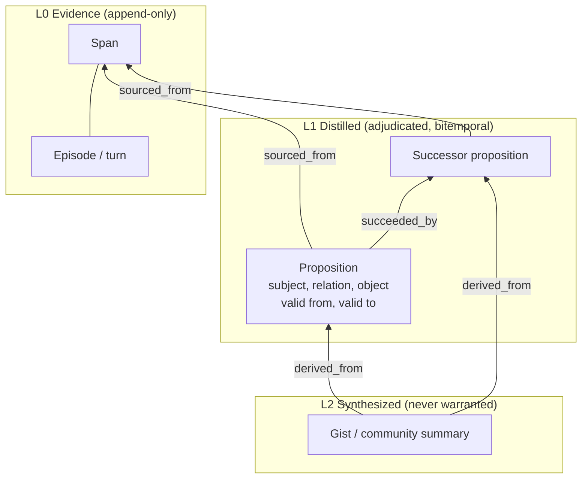
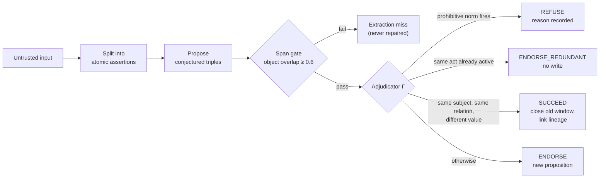

Most agent memory stores history first and governs it afterward, if at all. GMem reverses the order: every item is checked on the way in, versioned when it changes, and the system answers "I don't know" when the file is empty. This report describes the design, the measured standing against mem0 and cognee, and the approaches that failed. The failures are included because they constrain the design more than the wins do.

**Summary of findings.**

- On a matched 105-question LoCoMo slice, GMem reaches F1 0.423 against mem0's 0.435 and the highest exact match of the three (0.247 vs 0.148 vs 0.037).
- On HaluMem QA (70 questions) GMem leads overall (0.457 vs 0.400 and 0.386) and abstains correctly on all 13 boundary probes.
- Off the tuning slice, on the full 1,986-question corpus, the lead reverses: GMem F1 is 0.300, behind mem0 (0.411) and behind a no-memory base model given raw context (0.390). The headline claim cannot be F1 leadership.
- The measured defensible edges are exact match, abstention honesty (0.991 vs 0.959 for raw context), and auditable provenance at roughly 1,350 context tokens per question.

## 1. Problem

Agent memories are predominantly flat token histories or planar entity graphs. Both collapse abstraction levels: a retrieved triple carries no auditable path to its source span, and a summary carries no path to its supporting facts. The survey literature names the consequence directly: no traceable access paths, no verifiable updates, hallucination without abstention (Hu et al., 2026, §7.7). GMem is one minimal attempt at that frontier, scoped to factual memory only. It makes no claim on experiential strategies, skills, parametric storage, or privacy controls.

## 2. Architecture: three layers, one checker

The representation contract has three addressable planes with typed cross-layer edges:

| Layer | Contains | Write rule |
|---|---|---|
| L0 Evidence | Immutable interaction records (episodes, spans) | Append-only, never edited |
| L1 Distilled | Relational propositions | Admitted only through adjudication, with validity windows; updates close windows, never delete |
| L2 Synthesized | Summaries, communities | Always list their sources; can never enter the warranted store |

Links between layers use a closed, domain-free vocabulary: sourcing (proposition to span), derivation, gist membership, lateral relation, community grouping, and temporal succession with lineage. Every distilled proposition links to at least one source span; every synthesis lists its full source set. Any returned claim drills to its source span in at most three steps.

### 2.1 The write path

A single checker adjudicates each candidate proposition. The formal model defines it as a total function over four outcomes: endorse, endorse as redundant, succeed an earlier claim, or refuse with a recorded reason.

Three design decisions are worth stating, because each one is pinned by a test in the repository's conformance suite:

- **The span gate is a hard threshold, and it was measured.** The gate requires 60 percent of object tokens to occur in the source span, with all subject tokens present. A pilot sweep put 0.5 at the same recall as 0.6 but precision 0.82 versus 1.00, so 0.6 is the default.
- **Closure uses the system clock, never model time.** When a conflicting value arrives, the old proposition's validity window closes at write time. A hallucinated date cannot rewrite history.
- **Gate failures are extraction misses, never repairs.** The system does not guess its way into storing something the source does not support.

Governance is packaged as priority-ordered norms with a corroboration lifecycle (for example, dosage-required and recalled-drug-forbidden in a healthcare adapter, citation-shaped identity in a legal one, per-service deploy succession and main-branch-protected in an engineering one). The core stays domain-blind: it reasons about layers, never about patients, drugs, or contracts.

### 2.2 The read path

Reading is read-only and cited, through seven operations: overviews that start at syntheses, drill-downs that expand syntheses into propositions and then spans, coverage checks in the reverse direction, lateral walks with temporal and namespace filters, faceted slices by kind or provenance, time travel that reconstructs past states from validity windows, and provenance traces back to source spans for any returned item.

The consultation procedure is deliberately small and deterministic. It seeds entities by name overlap (at most 6), traverses at most 2 hops, filters on namespace equality and the active predicate `vf ≤ t < vt`, ranks the top 30 by a lexical score plus bonuses (subject, content, morphology, date, temporal intent, proximity), and abstains on an empty view. Temporal bonuses fire only when a nonzero content signal is present, a rule that came out of the failure analysis in §4. Empty evidence returns an explicit empty with a reason. It never synthesizes filler.

Retention is tiered without deletion: hot and cold tiers hold consultation cost flat while every byte stays drillable. The only destructive operation, `forget`, removes claims, never log entries.

## 3. Measured standing

All numbers below come from the project's committed results ledger. Every external comparison uses the same harness, the same seed (42), the same questions, a shared answer composer and a shared token-F1/exact-match scorer. Figures marked slice are diagnostic and carry no interval; only full runs are citable.

### 3.1 LoCoMo, matched slice

October 2026 remeasure on LoCoMo full-QA, conversation 30 (105 questions):

| Backend | F1 | EM | Wall time | Notes |
|---|---|---|---|---|
| mem0 2.2.1 | 0.435 | 0.148 | 223 s | verbose partials |
| gmem | 0.423 | 0.247 | 594 s | highest exact match |
| cognee 1.6.2 | 0.321 | 0.037 | 706 s | upstream regression noted in log |

The gap to mem0 on F1 is 0.012, about two questions. cognee fell from 0.443 to 0.321 on version 1.6.2 because its temporal search path raises `QueryInterval` validation errors and degrades silently; that is an upstream bug, not a harness artifact, and it is recorded in the log rather than hidden.

### 3.2 HaluMem, where abstention is scored

HaluMem QA probes whether a memory system answers, corrects, or refuses. Twenty seeded sessions yield 70 questions across five types.

| Slice | gmem | cognee 1.6.2 | mem0 2.2.1 |
|---|---|---|---|
| All (70) | **0.457** | 0.400 | 0.386 |
| Memory Boundary (13) | **1.000** | 0.769 | **1.000** |
| Basic Fact Recall (12) | **0.500** | **0.500** | 0.333 |
| Generalization (13) | **0.385** | 0.154 | **0.385** |
| Dynamic Update (11) | 0.273 | 0.273 | 0.273 |
| Memory Conflict (21) | 0.238 | **0.333** | 0.095 |

Reading the slices honestly matters more than the headline:

- **Boundary is a tie, and mem0's tie is accidental.** mem0 abstains most often (0.629) because its retriever frequently returns nothing, which is correct by luck. GMem abstains on all 13 boundary probes through the gate. The difference only shows when the retriever returns something plausible.
- **Conflict belongs to cognee.** Its graph context carries corrections that GMem's composer misses. Under a strict F1 scorer, GMem's conflict score was 0.048; four misses were correct but verbose and were recovered by a fairer polarity-plus-content scorer.
- **Dynamic update is a three-way tie at 0.273.** §4.5 traces this to a single mechanism.
- **Over-answering is not the disease.** On this slice, every GMem abstention had non-empty evidence. The conservatism is on the composer side, facing retrieved but diffuse evidence.

On the doubled-length, distractor-packed variant (HaluMem-Long, 81 questions), the overall score is flat (0.469 vs 0.457) and boundary stays at 21 of 21. What collapses is generalization, from 0.385 to 0.150: near-miss evidence outranks the gold turn and the composer answers confidently from it. This is the single most informative degradation in the ledger, because it isolates the failure to one question type.

### 3.3 Off the tuning slice

The two tables above are on the conversation the system was tuned against. The ledger also holds what happens when that stops being true.

| Conversation | gmem F1 / EM | mem0 F1 / EM | cognee F1 / EM |
|---|---|---|---|
| conv-30 (105Q, tuning) | 0.405 / 0.259 | 0.471 / 0.210 | 0.399 / 0.099 |
| conv-44 (158Q) | 0.289 / 0.122 | 0.411 / 0.146 | timeout |
| conv-43 (242Q) | 0.332 / 0.163 | 0.444 / 0.230 | 0.386 / 0.101 |

Across the full corpus (10 conversations, 1,986 questions, per-sample store reset), each backend with its intended configuration:

| Backend | F1 | EM | Date EM | adv_clean | Evidence lines | Context tokens | Wall |
|---|---|---|---|---|---|---|---|
| mem0 @ 20 | 0.411 | 0.155 | 0.180 | 0.991 | 2 | ~330 | ~4.1 h |
| fullctx (base model, no memory) | 0.390 | 0.064 | 0.087 | 0.959 | 1,738 | ~21,700 | ~3.6 h |
| cognee GRAPH_COMPLETION @ 20 | 0.352 | 0.055 | 0.087 | 0.872 | 1,608 | ~21,200 | ~4.2 h |
| gmem llm @ 1 | 0.300 | 0.108 | 0.122 | 0.991 | 20 | ~1,350 | ~2.9 h |

Three facts stand out. First, a base model reading the raw conversation beats GMem on F1 (0.390 vs 0.300), which means retrieval and extraction destroy more information than the composer rules recover once the question is off the tuning slice. Second, GMem keeps its edges where the design predicts them: exact match over raw context (0.108 vs 0.064, driven by deterministic date handling) and abstention honesty (0.991 vs 0.959, because the base model hallucinates on about 4 percent of adversarial probes). Third, mem0 leads F1 while answering from about 330 tokens, a result GMem does not match on cost either.

A methodological correction belongs in the record. The first full-corpus run measured all ten conversations through one accumulating store and scored 0.286. A per-sample reset re-measured it at 0.300, with 9 questions fixed and 6 newly broken. The contamination effect is real but small, since retrieval is entity-anchored and foreign facts rarely surface. The invalidated number is kept in the ledger as a bound on the artifact, not deleted.

### 3.4 Where the errors come from

The 1,986-question GMem run produced a classified failure split:

Of 1,375 classified failures, only 7 are retrieval misses and 59 are extraction misses. The mass is in temporal handling (649) and composer abstentions (495). The system is not failing to find the memory; it is failing to use it.

A 20-case manual audit of strong-coverage abstentions, each with evidence read in full, gives the mechanisms:

| Mechanism | Cases of 20 | Example |
|---|---|---|
| Distractor saturation or rank miss | 7 | other franchises outrank "Harry Potter"; phrasal fragments for "take up painting" |
| Date-mismatch caution | 4 | aerial yoga logged Dec 2022, asked about Dec 2023 |
| Multi-hop or joint synthesis | 4 | answer spans two lines or two people's records |
| Temporal scoping | 2 | outdated drum history outranks the as-of fact |
| Inference gap | 2 | residence implied by a family photo, never stated |

A shrink-and-test control found that no case was fixed by simply supplying more evidence. The ranking-side classes (distractor saturation, temporal scoping) form the addressable plurality: 9 of 20.

Evidence coverage measured offline from the recorded composer log (n = 1,576 matched questions) shows how slowly a wider window pays:

The offline pipeline reproduces the manifest F1 (0.294 vs 0.300) and gives the first honest interval on a headline number: bootstrap 95% CI [0.275, 0.311].

### 3.5 What produces the lead on the tuning slice

An ablation disabled the deterministic date-answer rules (`COMPOSER_NO_OVERRIDE=1`) on a 12-question slice, leaving pure retrieval plus the LLM composer.

The rules contribute about +0.11 F1 and +0.17 EM. Without them GMem trails every external system on the slice. The LLM misreads dates even when the right facts are present ("next month" resolved from a raw span; "27 January" off by one day). So the honest statement is that the lead on the tuning slice comes from validator-first date handling, not from superior retrieval. That is the system working as designed, and it is stated here so the table cannot be misread.

### 3.6 Trust is model-dependent

The same pipeline was run on Qwen3-4B (a Kaggle 2×T4 server behind vLLM) to test whether the architecture or the model carries the abstention behavior.

| Metric | Gemma | Qwen3-4B |
|---|---|---|
| 105Q F1 | 0.423 | 0.359 |
| 105Q EM | 0.247 | 0.136 |
| Resolution splits | 16 | 34 |
| Abstentions (105Q) | not tabulated | 0 |
| Boundary probes answered wrongly | — | 13 of 13 |
| Naive lexical floor F1 | — | 0.198 |

The SLM tax is about 0.06 F1 with coverage intact (3 extraction misses, same as before). But the 4B model answers everything, including all 13 boundary probes, wrongly. The trust story is model-dependent, not architecture-guaranteed. Memory still beats the lexical floor by +0.161 F1 on the same model.

The competitor cells on this hardware are blocked, and the reasons are informative. mem0's extraction scaffold alone is about 7.9K input tokens (a 12K server context is required; the T4 ceiling is 8K usable). Qwen malforms mem0's update-decision envelope about 21 times per 369-turn run, silently dropping facts. cognee's single subtasks exceed a 100-second origin timeout at T4 throughput. A vendor system needs its vendor's native context and throughput, not just ours.

### 3.7 Retrieval ceiling: a probe that never answers a question

LoCoMo QA rewards end-to-end answering and never probes the retriever. The LoCoMo-Plus probe isolates first-stage retrieval on 401 cue-to-trigger pairs with a closed corpus and the same embedder (bge-small-en-v1.5):

| Ranker | MRR | R@1 | R@5 | R@20 | Mean rank |
|---|---|---|---|---|---|
| dense (bge-small) | 0.044 | 0.010 | 0.055 | 0.157 | 115.0 |
| BM25 | 0.012 | 0.000 | 0.005 | 0.042 | 212.1 |
| RRF dense + BM25 | 0.025 | 0.002 | 0.022 | 0.090 | 142.7 |

First-stage retrieval is nearly blind on time-gap relational pairs. This reproduces the original benchmark's finding with an independent stack, and fusion does not rescue it. It is the likeliest ceiling on full-QA, since relationally linked evidence never reaches the answerer. A parallel preference-retention probe (113 items) found retention at 0.088 with no distractors, decaying to 0.044 at 50. The mean gold rank stays near 0 to 2, so ranking is fine; coverage is the disease, because preference questions share no content tokens with the stored fact ("bakeries" vs "gluten-free diet").

### 3.8 Unsupported claims and cost

The hallucination side of the contribution is measured with a claim-level metric: a claim sentence is supported when half its content tokens meet in a single evidence line.

| System | Claims | Unsupported | Rate |
|---|---|---|---|
| gmem, heuristic v1 (full corpus) | 1,063 | 61 | 0.057 |
| gmem, judge-calibrated | 1,063 | 49 | 0.046 |
| base model, full context (12-Q) | 12 | 3 | 0.250 |

The heuristic overcounts by about 20 percent; a cached-verdict LLM judge rescues paraphrase-supported claims. A citation-precision proxy (one minus the unsupported rate) reads 0.954 for GMem versus 0.750 for the base model, though the base-model sample is only 12 claims and the judge numbers await a human spot-check and a kappa gate before they count as claims. The honest label is calibration, not result.

Cost sits beside quality because the 2026 survey found only about a fifth of memory papers report any efficiency metric. GMem answers from roughly 1,350 context tokens against about 21,700 for raw context, a 16-fold reduction, and finishes the full corpus in about 2.9 hours versus 3.6 to 4.2 for the others. mem0 is cheaper still on context (about 330 tokens), so cost does not rescue the F1 deficit.

### 3.9 Judge accuracy versus exact match

Exact match understates capability. Re-scoring the compact-configuration 12-question run with a rubric judge gives accuracy 0.667 (8 of 12) against EM 0.500; the gap is exactly the two partial-credit answers. The judge model equals the composer model, so same-model bias is declared and the calibration gate applies before any claim is made.

## 4. What did not work

The ledger records negatives with the same care as wins, because each one removed an option from the design space. The repository's negatives file lists twelve earlier null results (span threshold 0.5, destructive succession, dual grounding paths, per-sentence LLM ingestion at 700 or more calls per conversation, a rule-based extractor yielding 5 propositions from 369 turns, a gate ablation that tied at 1.00 on clean data because nothing hallucinated, and others). The restudy round adds the following.

### 4.1 Retrieval and ranking

- **Semantic reranking.** Local embedding fusion wired end to end: within run variance of baseline at roughly twice the wall time. Default stays off. Retrieval breadth was adequate; precision into the top ranks and composer focus were the bottlenecks, in that order. At micro scale the same fusion added 100 to 400 times the latency for no recall delta.
- **Query expansion.** LLM terms appended for recall: F1 fell while one correct abstention flipped to a confident wrong answer. Query drift in, honesty out. Rejected as a default.
- **Unconditional temporal bonuses.** Dated noise outscored an undated content-gold fact because the date, past, future and event bonuses fired on any dated fact ("When did Gina get her tattoo?" lost to other dated Gina facts). Gating all four on a nonzero content signal moved the 12-question slice from 0.719 to 0.749 and abstention misses from 1 to 0. This one is a win that came out of a negative.
- **Query-date proximity.** A decaying boost for evidence near the question's own date fixed the motivating case at retrieval level (gold material now top-4) but left end-to-end HaluMem flat at 0.457 because the composer still picked line 5 over lines 1 to 4. Selection among good evidence is the exposed bottleneck.

### 4.2 Composition

- **Two-stage composer.** Answering from a sharp top-5 window with fallback expansion scored well below the single full-window pass. The first stage accepted plausible-but-wrong answers that the full evidence would have corrected.
- **Compact evidence rendering.** Same exact answers for roughly a quarter of the tokens, at a small F1 cost on partials. Kept as a cost option, not a quality claim.
- **Always-restating evidence.** Leading every evidence line with a resolved restatement ("Subject relation object. (span)") lifted full-QA from 0.408 to 0.430 with two fixed and none broken. The residue is extraction-side, since stored triples themselves embed "my job".

### 4.3 Extraction

- **Deterministic pronoun pre-resolution.** Unit-clean, live-negative on both slice and full scale. Pre-resolution strips the pronoun signal the proposer model uses for its own context-aware resolution, and a wrong name is confident poison where a vague pronoun was merely dilute. Reverted.
- **Rule extraction on natural text.** On HaluMem, the rule proposer extracted 28 propositions against 202 gold (recall 0.005, precision 0.036). Swapping in the LLM proposer lifted recall to 0.584, with important facts preferentially captured (0.692 vs 0.558 for standard ones). The price was over-extraction: 2,823 stored against 202 gold.

### 4.4 Long-context scale

- **Scale defeats the small model before answering starts.** On LongMemEval-S, each question carries its own roughly 53-session haystack (about 518 turns). The first 13 questions on Qwen3-4B scored 0 of 13 across all six types, with a best non-abstain F1 of 0.10. Pace (about 45 calls and 30 minutes per question) ruled out larger slices on that hardware.

### 4.5 Succession: the mechanism behind the update slice

Fifty original-to-updated pairs from HaluMem were replayed through a fresh store, then classified.

The succession rate over extracted pairs is 0.234. Extraction is fine (47 of 50 stored both sides). The failure is closure: adjudication compares raw relation strings, but the LLM emits tense and paraphrase variants across turns ("explored" vs "is exploring", "had" vs "has"), so both facts stay active. This is the mechanistic root of the 0.273 dynamic-update score.

The obvious fix, a head-verb canonicalization, was tried and reverted:

| Configuration | Succession rate | 12-Q F1 |
|---|---|---|
| Baseline | 0.234 | 0.719 |
| Head-verb canon, unguarded | 0.404 | 0.528 |
| Head-verb canon, guarded | 0.277 | 0.665 |

The unguarded rule nearly doubles succession and costs 0.19 F1, because relations packed with their complements make "same act" undecidable lexically. Embedding-tier or slot-aware succession remains open, and this is the result most likely to turn into a future paper section.

### 4.6 The pattern

Prompt-level rules are noise-fragile, lexical fixes fail where the phenomenon is semantic, and anything that spends the abstention budget must carry its hallucination measurement with it.

## 5. Position against related systems

Three 2025 to 2026 systems bound the design space. All three were checked against the full paper text (arXiv HTML versions).

**A-MEM** (Xu et al., 2025) builds Zettelkasten-style atomic notes with LLM-generated context, links and memory evolution. It reports an 85 to 93 percent token reduction against baselines on LoCoMo. Every interaction becomes a note, with no admission step. Evolution is destructive: the evolved note "replaces the original memory", with a timestamp but no validity interval. Notes keep their original interaction content, which gives partial provenance. Its metrics are F1, BLEU, ROUGE, METEOR and SBERT similarity; the LoCoMo adversarial category is a question type, not a memory-side abstention mechanism. The two ideas compose rather than compete: A-MEM's linking could sit above an adjudicated store.

**PISA** (Jia et al., 2025) maps Piaget's assimilation and accommodation onto three update modes (schema updation, evolution, creation). Schemas start from templates derived from the agent's goal with empty values and are then created at runtime. Matching uses similarity thresholds (0.70 at schema level), which route an experience to update or create but do not refuse it. Each schema entry carries an Experience ID linking to its source event, so provenance is present. Conflicts deactivate losing records without retaining them as history. Evaluation uses LLM-judged accuracy on LoCoMo and its own AggQA benchmark, with no abstention or hallucination metric.

**Memanto** (Abtahi et al., 2026) uses thirteen predefined memory categories. A built-in conflict check flags contradictions between same-type memories and asks the agent to supersede, retain or annotate before the contradiction is persisted, which is a real write-time gate. It defines the "Memory Tax" as the cumulative increase in compute cost, latency and system complexity. All accuracy figures use Claude Sonnet 4 as judge, a different metric from token-F1, so the numbers should never be compared raw. Provenance is listed as a design goal; the architecture sections do not describe how it is stored. No abstention or hallucination rates are reported.

| Property | A-MEM | PISA | Memanto | GMem |
|---|---|---|---|---|
| Write-time gate | none, every interaction stored | similarity routing, no refusal | conflict check, agent resolves | adjudicator with 4 outcomes and recorded refusal reasons |
| Superseded facts | overwritten | deactivated | supersede, retain or annotate | closed validity window, lineage kept |
| Source provenance | original content stored | Experience ID link | stated goal, mechanism not described | span link required, drill-down in at most 3 steps |
| Abstention or hallucination metric | none | none | none | boundary probes, unsupported-claim rate |
| Primary accuracy metric | F1, BLEU, ROUGE | LLM judge | LLM judge | token-F1, EM, partly judge-checked |

Memanto is the closest relative on the write side, so the claim here is narrower than "no one gates writes". None of the three reports abstention or unsupported-claim accounting alongside its gate, and none enforces a closed cross-layer link vocabulary or priority-ordered domain norms. That combination is what this report defends.

## 6. Threats to validity

- **Shared composer and scorer.** Every external row measures retrieval under GMem's composer and token-F1/EM scorer on conversation-level slices. It is never a vendor end-to-end result. mem0's published 92.5 headline is managed-platform only and is not comparable.
- **Tuning leakage.** The system was developed against conversation 30. The sub-corpus lead reverses off-slice, as §3.3 shows. All forward claims use full-suite numbers only.
- **Version drift.** mem0 moved from 0.471 to 0.340 to 0.435 across 2.x versions, and cognee from 0.443 to 0.321. Pins are recorded and results are dated.
- **Judge bias.** Same-model judging is declared; pinned judge versions and span reporting reduce it but do not eliminate it.
- **Errors counted as misses.** 140 of 1,986 cognee questions errored on transient provider resets and one ingest failed, so its true capability reads slightly higher by an unknowable amount.
- **Single extractor, English only, no distributed deployment, no privacy or access-control evaluation.**

## 7. Next steps

In order: slot-aware or embedding-tier succession to close the 36 stale pairs; composer selection among good evidence (the exposed bottleneck after ranking fixes); formal model definitions with multi-model evaluation; one unified ablation table (configuration by F1, exact match, abstention, cost); and judge accuracy reported next to exact match everywhere.

Three claims would each constitute a publishable unit if they held at full-suite scale: citation precision at matched recall, temporal reconstruction accuracy, and unsupported-claim rate at bounded abstention cost. None is claimed as held yet. The currently supportable statement is narrower: date precision and abstention honesty at lower cost than raw context, with F1 below the best baseline.

## References

1. Hu, Y. et al. (2026). *Memory in the Age of AI Agents.* https://arxiv.org/abs/2512.13564
2. Maharana, A. et al. (2024). *LoCoMo: Evaluating Very Long-Term Conversational Memory.* https://arxiv.org/abs/2402.17753
3. Xu, W. et al. (2025). *A-MEM: Agentic Memory for LLM Agents.* https://arxiv.org/abs/2502.12110
4. Jia, S. et al. (2025). *PISA: A Pragmatic Psych-Inspired Unified Memory System.* https://arxiv.org/abs/2510.15966
5. Abtahi, S. M. et al. (2026). *Memanto: Typed Semantic Memory with Information-Theoretic Retrieval.*
