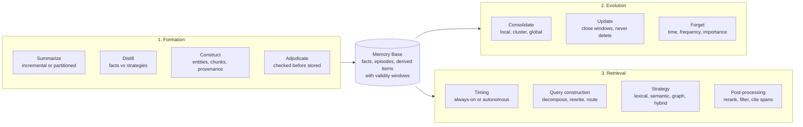

Part I covered forms (what carries memory) and functions (why agents need it), along with the tensions that define the field. This installment covers the third lens of the survey: dynamics, meaning how memory is formed, how it evolves, and how it is retrieved. The September tutorials on context budgets, memory layers, and retrieval are the applied counterparts of what follows.

All figures are reproduced from Hu et al. (2026), released under CC BY 4.0, via [arXiv:2512.13564](https://arxiv.org/abs/2512.13564). Figure numbers follow the original paper.

## 1. The lifecycle in one view

*Original diagram adapted from Figure 8 of Hu et al. (2026), CC BY 4.0. Formation turns raw experience into memory units; evolution maintains the existing store through consolidation, updating, and forgetting; retrieval serves the agent through timed, constructed, and consolidated queries.*

Three things are worth noticing before the details. The pipelines are not sequential stages of a single job: formation and evolution both write to the same store, retrieval reads from it, so the design question is which mechanisms each pipeline uses and how they interact. Across all three pipelines the survey reaches the same conclusion: naive append fails, and every fix trades something away. The mechanisms below also line up with the September tutorials, with summarization matching the compaction tutorial, updating matching the memory-layer tutorial, and retrieval matching the hybrid-search tutorial.

## 2. Formation: how memory is built

Four mechanisms, each with a characteristic failure mode.

**Semantic summarization.** Incremental summarization folds each new item into a running summary, avoiding quadratic reprocessing but suffering a serial bottleneck and cumulative error: each summary summarizes the previous summary, so early mistakes compound. Partitioned summarization processes chunks in parallel and loses cross-partition dependencies, which is why the survey concludes that summaries need provenance links to source chunks and a separate factual store. The practical rule from the compaction literature: a summary without a schema produces narrative, not working memory.

**Knowledge distillation.** Factual distillation produces verifiable, timestamped facts; experiential distillation produces heuristic, credence-scored insights. The survey's rule is strict: distill facts and strategies separately, never mix them, because a strategy stored as a fact gets treated as verifiable when it is only a heuristic. Contrastive success-failure pairs are the standard experiential technique.

**Structured construction.** Entity-level construction (preference graphs, noisy triples, community detection, personalized PageRank walks, bi-temporal facts) buys explainability and relational queries at the cost of schema rigidity, extraction cost, and LLM noise. Chunk-level construction (recursive summarization trees, bottom-up and top-down variants) is cheaper but flatter. The survey's hardening pattern, assert-then-validate with span assessment before commit, is the admission gate that separates checked memory from stored noise.

**Latent representation.** Dense and multimodal latent stores are infrastructure for finding candidates, never a source of truth. Any system that cites an embedding has confused the index with the record.

## 3. Evolution: how memory changes

Three mechanisms; in each case, the naive version fails.

*Figure 9 from Hu et al. (2026), CC BY 4.0. Memory evolution around the database: consolidation (local, cluster, global), updating (conflict resolution, parameter updates for external stores), and forgetting (expired time, low access frequency, low value).*

**Consolidation.** Local consolidation merges near-duplicates; cluster-level fusion groups related items; global integration applies principles across the store. The risk is smoothing outliers: aggressive consolidation discards the rare-but-critical fact. The defensible position, consistent with Part I's versioning-over-deletion tension, is to consolidate representations while preserving the underlying records.

**Updating.** Destructive replace (overwrite in place) breaks continuity: past-state queries become unanswerable by construction. Soft invalidation closes validity windows and preserves history. Dual-phase and reinforcement-learned update policies are the more recent variants. The survey's prescription is that updates close windows rather than delete, so time travel stays possible.

**Forgetting.** Time-based, frequency-based, and importance-driven forgetting all discard something the system later needs. Time-based forgetting kills rare-but-critical facts; frequency-based forgetting kills the one fact that mattered once. The pragmatic rule: if storage is cheap, do not delete. Soft-delete with validity windows, and let forgetting govern what is shown rather than what is kept.

## 4. Retrieval: how memory is consulted

Four phases, and the survey finds that query quality dominates retrieval architecture.

*Figure 10 from Hu et al. (2026), CC BY 4.0. The retrieval pipeline as a taxonomy of the literature, from timing and intent through post-retrieval processing, with representative systems per node.*

**Timing and intent.** Always-on retrieval concatenates everything into context; autonomous retrieval lets the agent decide when and what to fetch. The fast-then-deep variant (cheap first pass, expensive second pass only when needed) is the cost-aware middle ground.

**Query construction.** Decomposition splits multi-hop questions into sub-questions; rewriting bridges the vocabulary gap between questions and documents. The September retrieval tutorial's confidence router is the operational form: rewrite only when the baseline looks weak, because rewriting can hurt on ambiguous questions.

**Strategy.** Lexical retrieval is precise but brittle; semantic retrieval drifts and forces top-K noise; graph retrieval supports multi-hop walks with temporal filters; hybrid retrieval fuses channels. The survey treats post-processing as mandatory here: rerank, filter temporally, and cite spans for anything returned.

**Post-processing.** Re-ranking and filtering improve precision at measurable cost; aggregation and compression reduce token spend. Every returned item must cite its source span, and empty evidence must abstain rather than answer.

## 5. What this means for the series

Each mechanism in the dynamics half has an applied counterpart in the September tutorials. Summarization is the compaction tutorial's running-summary node. Updating is the memory-layer tutorial's validity windows. Retrieval is the hybrid-search tutorial's rank fusion and confidence routing. The next installments will go deeper on each: formation mechanisms in one article, evolution in another, retrieval in a third, with the measured verdicts from the restudy ledger alongside.

## References

1. Hu, Y. et al. (2026). *Memory in the Age of AI Agents.* https://arxiv.org/abs/2512.13564 (the map this series follows; CC BY 4.0; Figures 8, 9, and 10 reproduced with attribution)
2. Maharana, A. et al. (2024). *LoCoMo: Evaluating Very Long-Term Conversational Memory.* https://arxiv.org/abs/2402.17753
3. Shanian et al. (2026). *Better together: complementary query rewriting.* https://arxiv.org/abs/2609.05637
4. Kang et al. (2026). *Less Context, Better Agents.* https://arxiv.org/html/2606.10209v1
