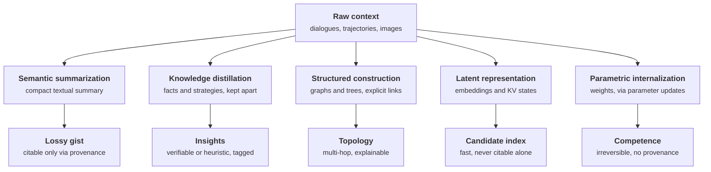

Part II covered the three dynamics pipelines at a distance. This installment and the next two take them one at a time, starting with formation: the process that encodes raw contexts, dialogues, images, trajectories, into compact knowledge. Everything downstream, evolution and retrieval included, inherits whatever this stage gets wrong.

The source remains Hu et al. (2026), released under CC BY 4.0 via [arXiv:2512.13564](https://arxiv.org/abs/2512.13564). Figure numbers follow the original paper. Where a mechanism deserves its own picture, the article also reproduces figures from the systems papers it cites, each under CC BY 4.0 and credited in place. Note that Part II presented four formation mechanisms; the survey's full taxonomy has five. The fifth, parametric internalization, closes this article.

## 1. Why formation exists at all

Full-context prompting, meaning feed the model everything, degrades on long, noisy, redundant inputs in three ways: computational overhead, prohibitive memory footprint, and worse reasoning on input lengths the model was not trained on. Formation is the response: compress before you store, then retrieve only what the current step needs.

The survey's framing is worth quoting in substance: formation selects what to extract based on the task's function. A tutoring agent and a procurement agent extract different things from the same conversation, because they need different memories to do their jobs. Formation is a design decision, not a generic preprocessing step.

## 2. The five operations

*Original diagram adapted from Section 5.1 of Hu et al. (2026), CC BY 4.0. The five operations differ in what they emit and what retrieval can later claim about it.*

The five differ along two axes: what the output looks like (text, structure, vectors, weights) and what it costs to retrieve from later. Table 5 of the survey maps every representative system onto these axes.

*Table 5 from Hu et al. (2026), CC BY 4.0. Each row names a system, its formation sub-type, what the memory looks like afterwards, and the core mechanism.*

## 3. Semantic summarization: incremental and partitioned

Summarization produces a lossy gist: global semantics in, local precision out. The survey splits it by how compression is scheduled.

**Incremental summarization** fuses each new chunk into a running summary. MemGPT and Mem0 did this with the model's own summarization ability, and the known failure is inconsistency and semantic drift: each pass summarizes the previous summary, so early errors compound. The literature's fixes arrive in three generations, and the progression is instructive. External evaluators first: a discriminator for consistency checks, a classifier to drop trivial content. Then reinforcement learning: Mem1 with PPO, MemAgent with GRPO, training the model to summarize rather than prompting it to. The trend runs from filtering output to shaping the summarizer, which reduces cumulative error but leaves the serial bottleneck intact.

*Figure 1 from Packer et al. (2023), CC BY 4.0. MemGPT's memory-creation operation under context pressure: the conversation is compressed into two facts appended to the working context. The summary is what survives; the turns that produced it are not kept.*

**Partitioned summarization** splits first, summarizes in parallel. MemoryBank segments by day or session; ReadAgent clusters semantically before summarizing; LightMem groups by topic. The efficiency gain is real, and the failure is the mirror image of the incremental case: independent processing of partitions loses cross-partition dependencies. A fact stated on Monday and corrected on Thursday lives in two summaries that never speak.

The practical rule, matching the compaction tutorial's schema requirement: summaries need provenance links back to their source chunks and a separate store for facts. A summary answers "roughly what happened"; it should never be the only record of "what exactly is true".

## 4. Knowledge distillation: facts and strategies, kept apart

Distillation extracts reusable knowledge at a finer granularity than summarization, and the survey is strict about the split.

**Factual distillation** produces declarative, verifiable knowledge: TiM abstracts dialogue turns into thoughts for persona coherence, MemGuide captures user intent and separates confirmed constraints from open goals, M3-Agent compresses egocentric visual observations into text-addressable facts about object locations.

**Experiential distillation** produces strategies from trajectories. Two source types: success, where AWM extracts workflow patterns from successful runs and Mem-pro distills gold trajectories into procedures; and failure, where R2D2 compares reasoning traces against ground truth to identify error sources. ExpeL combines both through contrastive reflection. The finer-grained variant, H2R, adds a second tier: after building the pool of high-level planning insights, it segments trajectories by subgoal to derive step-level ones.

*Figure 1 from Zhao et al. (2023), CC BY 4.0 (left panel). ExpeL's formation loop: gather trajectories into a pool, extract insights from success and failure pairs under upvote/downvote/edit actions, then recall them as guidance at evaluation. The insight pool is the durable artifact; the trajectories are disposable once distilled.*

The direction of travel in this subfield is from fixed extraction prompts to trained extractors: Memory-R1 trains only the fusion component, while Mem-alpha trains the model itself on what to extract and how to preserve it. Prompt-designed extraction is sensitive to prompt quality; trained extraction moves that dependency into the training distribution.

The separation rule matters more than any single system: distill facts and strategies into different stores. A heuristic stored as a fact gets retrieved with a fact's authority, and a fact demoted to a tip loses the verification path that made it useful.

## 5. Structured construction: graphs and trees

The first two operations leave memory as flat units. Structured construction adds topology, and the survey splits it by granularity.

**Entity-level construction** atomizes text into entities and relations. The simplest form is direct triple extraction (KGT for user preferences, Mem0's graph variant for conversation triplets), and the survey notes its limit: extraction quality is bounded by the model, so noise and structural errors enter the graph directly. D-SMART responds with a neuro-symbolic pipeline: first distill statements into assertion-like natural language, then extract an OWL-compliant graph fragment. Hierarchical variants follow: GraphRAG runs community detection and generates community summaries; AriGraph and HippoRAG add an episodic layer beside the semantic one; Zep formalizes three layers with a bi-temporal model, logging occurrence and processing times separately so "when it was said" and "when it became true" are distinct queries.

**Chunk-level construction** keeps text spans intact as nodes. RAPTOR recursively clusters chunks and summarizes clusters into a tree; the survey's through-line is static planar structures giving way to dynamic ones that absorb streaming trajectories, then to hierarchical ones. A-MEM's networked notes with semantic links is the representative case here, and it is the system the next installment takes apart in detail.

*Figure 1 from Sarthi et al. (2024), CC BY 4.0. RAPTOR's chunk-level construction: cluster text chunks, summarize each cluster into a node holding text plus an embedding, repeat upward until a root layer. The tree is the memory; each node stays citable back to the chunks beneath it.*

The trade the survey names: structural prior buys multi-hop reasoning and interpretability, and costs extraction compute plus schema rigidity. The assert-then-validate gate from Part II is the admission control that keeps the graph from becoming a noise archive.

## 6. Latent representation: the index that is not the record

Latent formation encodes experience directly into machine-native formats: vector embeddings, KV states, continuous representations. MemoryLLM maintains self-updatable latent embeddings, M+ distributes long-term memory tokens across layers, MemGen triggers and weaves latent memory on demand. The multimodal branch maps video to language to vector (ESR), or compresses vision-language pairs through a Q-Former (CoMEM).

The rule from Part II holds here without exception: latent stores are candidate-generation infrastructure. They are fast and compact, and they cannot be cited. Any answer that rests on an embedding needs a path back to a span or a fact, or it is a guess with good recall.

## 7. Parametric internalization: memory that stops being retrievable

The fifth operation writes memory into the model's weights: MEND decomposes edits into gradients, ROME localizes facts and applies rank-one updates, MEMIT extends this to mass editing, CoLoR trains low-rank adapters, ToolFormer fine-tunes on API-call selection. The survey's summary of the paradigm is precise: retrievable information becomes intrinsic competence.

The price is the loss of provenance and reversibility. A parameter edit cannot be traced to its source turn or cleanly undone the way a graph edge can, and it ages with the model version rather than with the fact's validity window. The defensible uses are capabilities and stable world knowledge, where the thing being internalized changes slowly and does not need to be cited. For user facts and episodic history, external memory with validity windows remains the safer substrate.

## 8. The operations compose

The survey's closing point on formation is the one to leave with: the five are not exclusive. Production systems translate across representations as data flows: summarize conversation, distill durable facts from the summary, build a graph over the facts, embed the graph for candidate retrieval, and internalize only what proves stable. The measured side of that claim, from the work I reported on in August, points the same direction: the systems that scored best on exact match were the ones holding structured, cited memory rather than narrative summaries, and the systems relying on summarization alone won partial-credit metrics while losing the questions that needed one specific fact.

## 9. What comes next

Part IV takes evolution apart the same way: consolidation at three granularities, the update policies that preserve history, and the forgetting mechanisms that decide what stays visible. Part V closes the series on retrieval, going deeper than Part II's taxonomy into the query construction and post-processing stages the September tutorial demonstrated.

## References

1. Hu, Y. et al. (2026). *Memory in the Age of AI Agents.* https://arxiv.org/abs/2512.13564 (the map this series follows; CC BY 4.0; Table 5 reproduced with attribution)
2. Packer, C. et al. (2023). *MemGPT.* https://arxiv.org/abs/2310.08560 (CC BY 4.0; Figure 1 reproduced)
3. Chhikara, P. et al. (2025). *Mem0: Building Production-Ready AI Agents with Scalable Long-Term Memory.* https://arxiv.org/abs/2504.19413
4. Sarthi, A. et al. (2024). *RAPTOR: Recursive Abstractive Processing for Tree-Oriented Retrieval.* https://arxiv.org/abs/2401.18059 (CC BY 4.0; Figure 1 reproduced)
5. Zhao, Q. et al. (2023). *ExpeL: LLM Agents Are Experiential Learners.* https://arxiv.org/abs/2308.10144 (CC BY 4.0; Figure 1, left panel, reproduced)
6. Edge, D. et al. (2025). *From Local to Global: A Graph RAG Approach to Query-Focused Summarization.* https://arxiv.org/abs/2404.16130
7. Rasmussen, M. et al. (2025). *Zep: A Temporal Knowledge Graph Architecture for Agent Memory.* https://arxiv.org/abs/2501.13956
8. Xu, Z. et al. (2025). *A-MEM: Agentic Memory for LLM Agents.* https://arxiv.org/abs/2502.12110
9. Meng, K. et al. (2022). *Locating and Editing Factual Associations in GPT.* https://arxiv.org/abs/2202.05262
