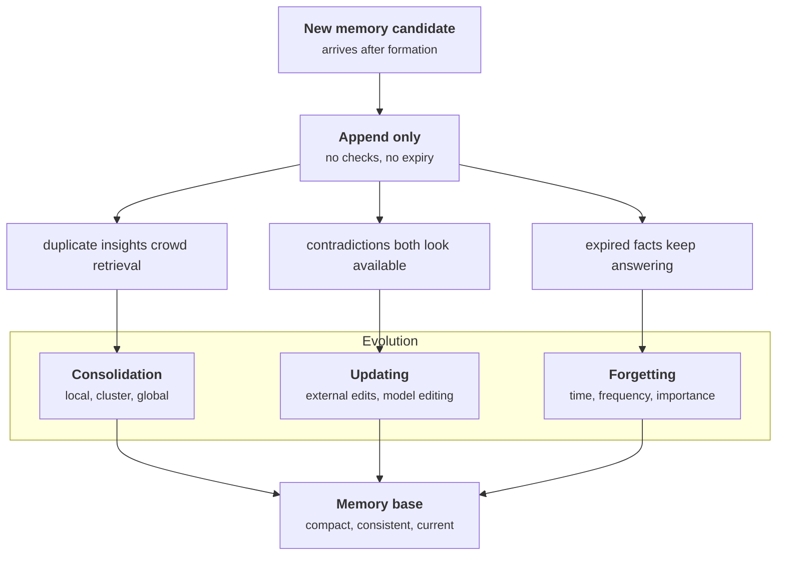
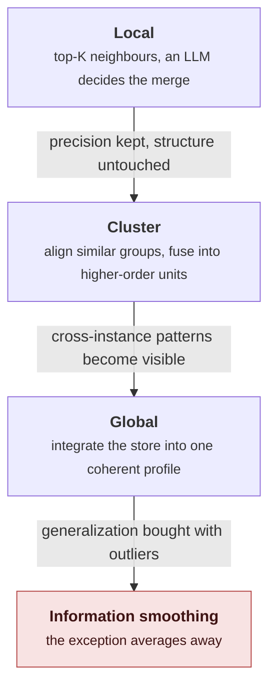
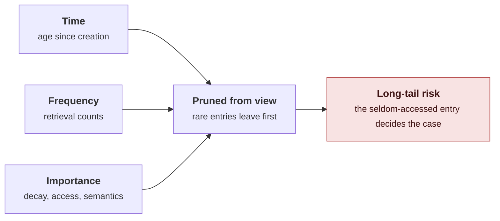

Part III took formation apart: the operations that turn raw context into stored memory. This installment takes the maintenance half. New memories keep arriving after the store exists, and how the store absorbs them decides whether it stays useful. The survey calls this evolution, and its three mechanisms are consolidation, updating, and forgetting.

The source remains Hu et al. (2026), released under CC BY 4.0 via [arXiv:2512.13564](https://arxiv.org/abs/2512.13564). Section numbers follow the original. The four reproduced figures come from systems papers the survey cites, each under CC BY 4.0 and credited in place.

## 1. Why evolution exists

Formation extracts memory from raw data. The next step is integration: new candidates arriving while the repository already holds entries that overlap with them, contradict them, or predate them. The naive strategy is to append and move on, and the survey names what that overlooks. An append-only store never checks semantic dependencies between entries, never resolves contradictions, and never notices that information has expired. Duplicates crowd retrieval, contradictory facts both look available, and expired facts keep answering questions they no longer fit.

Evolution is the set of mechanisms that maintain the store instead of only growing it. The survey splits it by objective. Consolidation merges related memories and synthesizes higher-level insights, so learning accumulates instead of sitting in isolated fragments. Updating resolves conflicts between new and existing memories, keeping the repository accurate as the environment changes. Forgetting removes outdated or redundant entries, keeping the repository focused and the retrieval path short.

*Original diagram adapted from Section 5.2 of Hu et al. (2026), CC BY 4.0. An append-only store fails three ways, and each evolution mechanism addresses one failure.*

Consolidation is about abstraction: it looks for what several memories have in common and stores the pattern. Updating is about correction: it takes one new memory and one old one, decides which holds, and records the change. Forgetting is about attention: it decides what stops competing for retrieval slots. A merge that should have been an update erases the correction. An update that should have been a consolidation overwrites a pattern with an instance. A deletion that should have been a visibility rule destroys the audit trail.

## 2. Consolidation: the granularity ladder

Consolidation transforms short-term traces into structured long-term knowledge. It works by finding semantic relationships between new and existing memories and folding them into abstractions. The survey gives it two purposes: reorganizing fragments into coherent structures, so critical details survive short-term retention and stable schemas form; and abstracting experience into reusable patterns that generalize across tasks.

The central design question is granularity: at what scale do new memories get matched and merged?

**Local consolidation** works on highly similar fragments. RMM retrieves the top-K most similar candidates for each new topic memory and has an LLM decide whether a merge is appropriate, which lowers the risk of incorrect generalization. In multimodal settings, VLN triggers pooling when capacity saturates, compressing the most similar or redundant pairs into higher-level abstractions. Local merges refine detail and improve storage efficiency while leaving the store's global structure alone. The limitation is structural: local matching cannot see cluster-level relations or the higher-order dependencies that emerge across related memories.

**Cluster-level fusion** works on groups. PREMem aligns new memory clusters with similar existing ones and applies fusion modes such as generalization and refinement, producing higher-order reasoning units. TiM periodically examines memories that share a hashing bucket and merges the semantically redundant ones. CAM merges every node in a target cluster into a representative summary. These methods buy cross-instance generalization and interpretability, at the cost of another layer of structure to keep coherent.

*Figure 1 from Kim et al. (2025), CC BY 4.0. PREMem's construction phase: a conversation is distilled into factual and experiential entries, then a reasoning step merges them into higher-order memories (the shrimp allergy accumulates into an allergy list) before anything reaches the store.*

**Global integration** works on the whole store. MOOM builds stable role profiles by combining temporary snapshots with historical traces, using rules, embeddings, and LLM abstraction. Matrix iteratively combines execution trajectories and reflective insights with global memory, distilling principles that carry across tasks. AgentFold and Context Folding apply the same idea to working memory, summarizing and condensing the global context after each step of long interactions.

*Original diagram adapted from Section 5.2.1 of Hu et al. (2026), CC BY 4.0. The ladder trades local precision for cross-instance generalization, and the last step is where the exception gets lost.*

The failure mode is uniform across the ladder: information smoothing. Abstraction keeps what repeats and averages away what does not, so an outlier event or a unique exception disappears into a summary that no longer represents it. A store consolidated this way becomes less sensitive to anomalies, which is exactly what an agent needs to notice. The rule to keep: consolidate the representation, keep the record. A merged profile can be the default view, as long as the instances behind it remain recoverable when a query needs the exception.

## 3. Updating: conflicts, history, and the policy ladder

Updating revises or replaces an existing memory when a conflict appears or new information arrives. Its goal is factual consistency and continued adaptation without retraining the model. Where consolidation asks what several memories mean together, updating asks which of two memories currently holds, and it answers that at the scale of a single entry.

Updates have two homes, external stores and model weights, and the survey traces the external line first. Early systems, MemGPT, D-SMART, and Mem0g among them, run a simple loop: the LLM detects a conflict, then invokes replace or delete. That works for basic factual repair and destroys history, because the old value is gone and past-state queries become unanswerable. Zep's fix was temporal: conflicting facts get invalid timestamps instead of deletion, so the store keeps both values and knows which one ended when. The move from hard replacement to soft, time-aware invalidation is what makes a memory system replayable. MOOM and LightMem add a second phase: a soft online update for responsiveness, then an offline pass where similar entries merge and conflicts resolve under LLM reasoning. The eventual-consistency split keeps latency low without letting the store drift. Mem-α takes the last step and learns the policy itself: reinforcement learning trains the model on when, how, and whether to update, with the reward coming from downstream question answering.

*Figure 1 from Wang et al. (2025), CC BY 4.0. Mem-α's before and after: the untrained agent never updates core memory and saves a thin episodic entry; after RL training, the same model writes durable facts to core memory and splits the conversation across episodic and semantic memory.*

What changed is where the decision lives: tool selection has moved from a prompt convention into the learned policy. The training loop is what puts it there. The agent reads chunks in order and edits memory as it goes, a separate fixed model answers questions from the resulting store, and the reward is scored on those answers and on the memory operations (tool calls, compression, memory quality).

*Figure 2 from Wang et al. (2025), CC BY 4.0. The loop behind the policy: the agent processes chunks in sequence and edits its memory, another fixed model answers questions from that memory, and the rewards score the answers and the memory operations (tool calls, compression, memory quality).*

Model editing attacks the same problem inside the weights. ROME locates the parameters that encode a fact by tracing their effect on the model's output and applies a targeted update; MEMIT extends the edit to batches of facts; Model Editor Networks train an auxiliary network to predict the adjustment. MemoryLLM takes a different route and keeps the weights fixed, embedding a memory pool inside the transformer layers and replacing memory tokens as new knowledge arrives. M+ extends the pool across layers, discarding obsolete short-term entries and compressing what matters into long-term storage. ChemAgent combines the external and internal paths, syncing factual and representational changes.

*Figure 1(b) from Wang et al. (2024), CC BY 4.0. MemoryLLM's self-update: the embedding of the new context is injected into the memory pool at each layer, so knowledge enters the model's state without touching its weights.*

Every mechanism in this section runs into the same trade-off, which the survey names as the stability-plasticity dilemma: deciding when to overwrite existing knowledge and when to treat new information as noise. Overwrite too eagerly and a mistaken or adversarial input corrupts the store; refuse to overwrite and the store holds a stale fact with full confidence. The survey's prescription matches the Zep line: updates close validity windows rather than delete, so time travel survives the correction. The memory-layer tutorial's validity windows are the applied form of that rule.

## 4. Forgetting: what leaves the store and what leaves the view

Forgetting is deliberate removal of outdated, redundant, or low-value information. It differs from updating in what it optimizes: updating resolves a conflict between memories, while forgetting removes what no longer earns its place, to free capacity and keep retrieval focused. An unbounded store accumulates noise, retrieval latency, and interference from stale entries, and every extra candidate dilutes the ranking. Prune too aggressively and the rare entry that would have decided the next question is gone.

The survey organizes forgetting by signal. Time-based forgetting uses creation time: MemGPT evicts the earliest messages when the context overflows, latent memory pools replace tokens at a fixed ratio and drop the oldest once the pool is full, and MAICC decays memory weights gradually instead of deleting outright. Frequency-based forgetting uses retrieval behavior: XMem applies LFU, KARMA tracks access with counting Bloom filters, and MemOS applies LRU while archiving the entries that were highly active. Importance-driven forgetting combines signals: MemoryBank and MOOM score entries by decay and access, VLN pools semantically redundant memories, Livia adds emotional salience, and TiM and MemTool let an LLM judge what matters.

*Original diagram adapted from Section 5.2.3 of Hu et al. (2026), CC BY 4.0. The three forgetting signals share one failure: the entry that is rarely seen is exactly the one a later question may need.*

The survey's own warning about this family is the one to keep: heuristic policies like LRU remove long-tail knowledge, the entries that are seldom accessed and decisive when they are. Its practical conclusion is that when storage is not the binding constraint, the better move is not to delete. Soft deletion and validity windows let forgetting govern what is shown rather than what is kept: the entry drops out of the retrieval view while remaining available for the audit, the replay, and the one query that needs it. That reframes forgetting as a visibility policy: what leaves is the retrieval view, not the record.

## 5. How the three compose

Take one fact: a user says she moved to Berlin. Updating notices that the store holds an older city and closes its window instead of overwriting it. Consolidation folds the move into the profile that other facts about her are building, so the change reaches every view that depends on where she lives. Forgetting keeps the closed window out of the default retrieval set, so it does not compete with the current one. None of the three could do the job alone: a merge without an update would blur the two cities into one, an update without consolidation would leave the profile stale, and no forgetting would let the old city resurface on every city question.

The mechanisms feed each other: consolidation supplies the abstractions that updating corrects, updating supplies the closed windows that forgetting hides, and forgetting keeps the working set small enough that merging stays tractable. The survey's closing position on evolution is the same one it takes on formation: the three are not exclusive, and production systems run them continuously rather than as one-off passes.

The applied counterparts are already on the blog: the memory-layer tutorial's validity windows are updating's external form. The compaction tutorial's running summary compresses context, and consolidation is the step above it, where several memories become a profile. Part II drew those connections at a distance; the mechanics here are what the tutorials implement in miniature.

The systems here each report their own evaluations, on their own benchmarks, so nothing in this installment adds up to a ranking. The survey's claim is structural: evolution is required, and the mechanisms above are the ways systems meet it.

## 6. What comes next

Part V closes the series on retrieval, going deeper than Part II's taxonomy: when retrieval fires and why, how queries get decomposed and rewritten, the strategies from lexical to graph and hybrid, and the post-processing that decides what the model actually reads. The September hybrid-search tutorial is the applied counterpart.

## References

1. Hu, Y. et al. (2026). *Memory in the Age of AI Agents.* https://arxiv.org/abs/2512.13564 (the map this series follows; CC BY 4.0)
2. Kim, S. et al. (2025). *Pre-Storage Reasoning for Episodic Memory: Shifting Inference Burden to Memory for Personalized Dialogue.* https://arxiv.org/abs/2509.10852 (CC BY 4.0; Figure 1 reproduced)
3. Packer, C. et al. (2023). *MemGPT: Towards LLMs as Operating Systems.* https://arxiv.org/abs/2310.08560
4. Chhikara, P. et al. (2025). *Mem0: Building Production-Ready AI Agents with Scalable Long-Term Memory.* https://arxiv.org/abs/2504.19413
5. Rasmussen, P. et al. (2025). *Zep: A Temporal Knowledge Graph Architecture for Agent Memory.* https://arxiv.org/abs/2501.13956
6. Wang, Y. et al. (2025). *Mem-α: Learning Memory Construction via Reinforcement Learning.* https://arxiv.org/abs/2509.25911 (CC BY 4.0; Figures 1 and 2 reproduced)
7. Wang, Y. et al. (2024). *MemoryLLM: Towards Self-Updatable Large Language Models.* https://arxiv.org/abs/2402.04624 (CC BY 4.0; Figure 1(b) reproduced)
8. Meng, K. et al. (2022). *Locating and Editing Factual Associations in GPT.* https://arxiv.org/abs/2202.05262
9. Meng, K. et al. (2023). *Mass-Editing Memory in a Transformer.* https://arxiv.org/abs/2210.07229
10. Xi, R. and Wang, X. (2025). *Livia: An Emotion-Aware AR Companion Powered by Modular AI Agents and Progressive Memory Compression.* https://arxiv.org/abs/2509.05298
