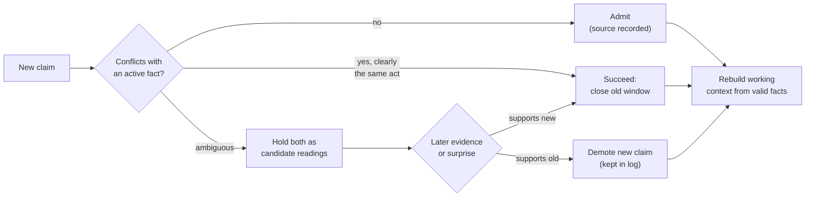

Agent memory fails in four ways that get discussed as separate problems: drift, poisoning, catastrophic forgetting and hallucination. This post argues they are one problem seen from four sides. Several stored or in-context states compete, one wins, and nothing in the system tracks that a contest happened. Perceptual science has studied exactly this situation for a century, under the name multistability. I surveyed the literature to see what it suggests for memory and context design. The short answer: the pieces exist in separate fields, and I did not find anyone who has put them together.

This is a survey with opinions, not a result. I ran no new experiments for it. Where a claim rests on an abstract only, I say so.

## 1. Four failures, one shape

| Failure | What it looks like | What is competing |
|---|---|---|
| Drift | An answer shifts after the conversation moves on or a user pushes back | The old context versus the current evidence |
| Poisoning | A false or hostile claim becomes a stored "fact" | An unreliable source versus an established memory |
| Catastrophic forgetting | New learning overwrites old knowledge | New traces versus old traces in a shared store |
| Hallucination | A confident answer with no support | A fluent completion versus no stored basin at all |

In each row two or more states want the same slot, and the output looks equally confident whichever wins. That is why output-level monitoring (watching entropy, asking the model if it is sure) struggles with all four.

## 2. What multistability is

Show someone a Necker cube or two different images, one per eye. They do not see a blend. They see one interpretation, which then flips to the other, over and over. The flipping has structure:

- **Dwell times are variable.** Alternations are stochastic, and noise appears to play a fundamental role in setting their timing ([Brascamp et al., 2006](https://doi.org/10.1167/6.11.8); [Kim et al., 2005](https://doi.org/10.1016/j.visres.2005.08.009)).
- **The winner fatigues.** Models of rivalry give adaptation a central role in producing the switches ([Theodoni et al., 2011](https://doi.org/10.3389/fnhum.2011.00145)).
- **There is memory.** Rivalry shows hysteresis, so the next percept depends on the recent one ([Wilson, 2007](https://doi.org/10.1016/j.visres.2007.07.007)).
- **It looks like inference.** Gershman, Vul and Tenenbaum argue that switching, patchy percepts, fusion and traveling waves can be explained as MCMC sampling over simple graphical models ([2012](https://dspace.mit.edu/handle/1721.1/70125)). Moreno-Bote, Knill and Pouget report that how long each percept dominates follows what Bayesian sampling predicts ([PNAS 2011](https://pmc.ncbi.nlm.nih.gov/articles/PMC3145684)). A separate line argues that predictive coding explains rivalry (Hohwy, Roepstorff and Friston, [2008](https://doi.org/10.1016/j.cognition.2008.05.010)).

I read the abstracts of the Gershman paper and the PNAS paper summary, not their full text. I could not confirm that the Gershman paper makes dwell-time or hysteresis claims, so I do not attribute those to it.

The useful reading for engineers: the brain does not resolve an ambiguous input once and for all. It keeps a distribution over interpretations, shows one at a time, and lets evidence, fatigue and noise move the winner.

## 3. The same dynamics already live inside LLMs

This is the part that surprised me. The vocabulary of multistability is already being used for language models, just not for memory design.

- **Attractor basins.** [Attractor Geometry of Transformer Memory](https://arxiv.org/abs/2605.05686) (Liang et al.) argues that learned facts form attractor basins in hidden-state space. Conflict between parametric memory and context is basin competition, which disrupts convergence to the correct basin without raising output entropy. Hallucination is basin absence, where the hidden state drifts freely. Both produce confident output, so monitoring the output is blind by design. I only read the abstract.
- **Metastable states in attention.** In modern Hopfield networks, the update rule is equivalent to transformer attention, and the energy landscape has fixed points that average over all stored patterns, fixed points that average over a subset, and fixed points that store a single pattern (Ramsauer et al., [Hopfield Networks is All You Need](https://arxiv.org/abs/2008.02217)). Blended retrievals are a built-in outcome of the retrieval mechanism, not a bug.
- **Winner-take-all in vision-language models.** On 29 bistable images with 116 manipulations, most of the twelve models tested strongly preferred one interpretation (Panagopoulou et al., [Evaluating VLMs on Bistable Images](https://arxiv.org/abs/2405.19423)). In a controlled illusion probe, models often keep their answer when the illusion is inverted, which raises the question of whether they perceive or recall (Sun et al., [VI-Probe](https://arxiv.org/abs/2601.22150)).
- **Hysteresis in conversation.** Shnaidman's [Reset Is Not Recovery](https://arxiv.org/abs/2609.33672) measures it directly. After a user repeatedly pushes a wrong answer and then stops, ordinary reset leaves a residue. Across 14 model and dataset pairs the mean gap to a clean-context baseline is 0.303, and the post-reset wrong-following rate is 41.2%. A same-length neutral history produces a gap of -0.007, so the effect is about content, not length.

That last paper also tests repairs, and the pattern is the most design-relevant result I found:

| Repair | Pairs recovered (of 14) |
|---|---|
| Ordinary reset, user retraction, system reset | 2 each |
| Self-verification | 3 |
| Neutral summarization | 11 |
| Factual-state reconstruction | 12 |
| Truncation, fresh-context deletion | 14 (oracle conditions) |

Telling the model to forget does almost nothing. Rebuilding the state from facts works much better. Removing the pressure turns entirely works best, and the authors are clear that deletion is an upper bound, not a deployable fix. Partial removal helps only partway: the mean gap was 0.462 with full history, 0.278 after dropping medium and strong turns, and 0.001 after dropping all pressure turns. The study uses multiple-choice questions, seven open-weight models, templated pressure and a single seed, so treat the numbers as a demonstration of the effect, not a general rate.

## 4. What this suggests for each failure

### Drift: keep state, not history

If instructions to disregard earlier turns barely work, the history itself is the problem. The design lever is to stop treating the transcript as the state. Keep a small set of validated facts with validity windows, and rebuild the working context from them each turn. This is where neutral summarization and factual-state reconstruction win in the table above. Bitemporal stores do this by closing a validity window on update instead of deleting, so "what is true now" and "what was said" stay separable.

### Poisoning: gate on source, not on content

[MemProbe](https://arxiv.org/abs/2609.30558) (Ding et al.) is the most useful recent evaluation here. It turns cognitive-memory paradigms (interference, misinformation, consolidation strength, reconsolidation window) into tests on 56 episodes across six memory systems. Overall scores ranged from 41.5% (Mem0) to 88.4% (A-MEM), against 88.8% for full context. The weak spot was source fidelity: 17.7% for Mem0, 41.9% for Graphiti and 66.1% for full context. A memory that cannot tell who said something cannot defend itself against a confident false claim. The design lever is an admission step that records source and refuses or demotes claims that conflict with a well-supported memory unless the evidence is strong. MemProbe's own framing of "consolidation strength" says the same: well-supported memories should resist weak challenges and still yield to reliable ones.

### Catastrophic forgetting: two stores and selective replay

The neuroscience answer is old. McClelland, McNaughton and O'Reilly argued in 1995 that the brain needs a fast hippocampal store and a slow neocortical one, because a single dense store learning quickly overwrites itself ([Psychological Review](https://doi.org/10.1037/0033-295x.102.3.419)). Fontaine and a co-author built a predictive-coding model of the neocortex that found the matching capacity limit: episodic-like recall emerged from a few examples, then disappeared when trained on many, because dense overlapping representations hold only a limited number of individual memories ([2509.01987](https://arxiv.org/abs/2509.01987)).

Two cautions from the replay literature:

- Replay is not automatically good. In a surprise-gated memory study, offline replay recovered 17.7 and 51.3 points of retention on the oldest classes for two backbones, but replaying only a recent window was worse than no replay at all (Mouchon, [2606.31495](https://arxiv.org/abs/2606.31495), ImageNet, single seed).
- Timing matters. Forgetting in LLMs appears to follow an Ebbinghaus-style curve, which motivates scheduling replay against the model's own notion of time instead of fixed step counts (Feng et al., [FOREVER](https://arxiv.org/abs/2601.03938)).

The design lever for agents is to never overwrite. Keep an append-only episode layer, distill into a second layer under admission rules, and consolidate selectively. Many 2026 systems now do some version of this, under names like sleep, dreaming and Hebbian consolidation (Xie's [SleepGate](https://arxiv.org/abs/2603.14517), Potineni et al.'s [EngramRAG](https://arxiv.org/abs/2609.32049), Zhu et al.'s [HeLa-Mem](https://arxiv.org/abs/2604.16839), Mody et al.'s [CraniMem](https://arxiv.org/abs/2603.15642)). SleepGate reports a drop in the interference horizon from O(n) to O(log n) and near-perfect retrieval, but on a 793K-parameter model, so it is a mechanism claim, not a field result.

### Hallucination: put the abstention outside the model

The attractor-basin account says hallucination is basin absence, and that the model's output looks equally confident. If that is right, abstention cannot depend on the model's own confidence. It has to live in the memory layer: if no supported evidence exists, return an explicit empty. The limit is that a gate in the memory layer only helps if the component that writes the answer honors it. A small model can simply ignore an empty result and answer anyway, so abstention has to be tested with the answering model in the loop, not assumed from the architecture.

## 5. The context window is a dilution problem

The window limit is usually framed as size. The evidence points elsewhere:

- Attention entropy rises as the number of items to track grows, and the capacity limit has been tied to dispersed attention (Gong et al., [Self-Attention Limits Working Memory Capacity](https://arxiv.org/abs/2409.10715), N-back tasks on vanilla decoder-only transformers).
- Performance is highest when relevant information sits at the start or end of the context and degrades in the middle (Liu et al., [Lost in the Middle](https://arxiv.org/abs/2307.03172)).
- MemProbe found that naive retrieval scored 29.2% on episodes whose evidence is split across turns, against 89.6% when the right turns were supplied directly. The window is not the bottleneck there; assembling the right evidence is.

So the lever is selection, not capacity. The systems that work on size do it by splitting memory by fidelity: a lossless recent window plus a compressed long-term store (Fang et al.'s [Artificial Hippocampus Networks](https://arxiv.org/abs/2510.07318), Munkhdalai et al.'s [Infini-attention](https://arxiv.org/abs/2404.07143), Behrouz et al.'s [Titans](https://arxiv.org/abs/2501.00663)). The systems that work on selection use surprise to decide what becomes an event (Fountas et al.'s [EM-LLM](https://arxiv.org/abs/2407.09450), Zhang et al.'s [HiMem](https://arxiv.org/abs/2601.06377)) and relationships to decide what gets retrieved (Gutiérrez et al.'s [HippoRAG](https://arxiv.org/abs/2405.14831)). One cost-oriented variant waits to consolidate until sustained recurrence appears, to save tokens (Dai et al.'s [RecMem](https://arxiv.org/abs/2605.16045)).

## 6. What multistability adds, and what it does not

Most of the above is established under other names: complementary learning systems, surprise gating, replay, reconsolidation. Song et al.'s [REALM](https://arxiv.org/abs/2609.16053), for example, revises stored memories based on retrieval feedback and shows that this step improves results in ablations. The sleep and Hebbian papers are crowded enough that another "we added sleep" system adds little.

What I did not find is anyone treating memory conflict itself as a multistable competition. The ideas I think are worth testing, clearly marked as hypotheses:

1. **Keep candidate readings alive.** When a new claim might or might not be an update of an old one, hold both as candidates and let later evidence resolve it, instead of committing at write time. The motivating failure is easy to reproduce: if two facts are compared by exact relation string, an extractor that varies tense or phrasing ("explored" versus "is exploring") leaves both facts active.
2. **Adapt away from the winner.** In rivalry the dominant percept fatigues. A retrieval policy that damps recently used evidence could let a lower-ranked but correct fact surface. The failure it targets is distractor saturation, where several near-identical facts compete for the top ranks.
3. **Measure hysteresis.** Treat residual influence of a retracted or superseded claim as a first-class metric, the way [Reset Is Not Recovery](https://arxiv.org/abs/2609.33672) does for conversations. It would also work as a probe for memory systems: after a correction, how often does the stale value still surface?
4. **Noise.** Rivalry models give noise a causal role. I searched for evidence that injected noise helps agent memory retrieval and found none, so this one is a pure open question.

None of this has been run. The sketch is a design hypothesis built from the evidence above, and the parts that are not already standard (the candidate-readings state, adaptation away from the winner) are exactly the parts without direct support.

## 7. Caveats

- This is a survey of titles and abstracts, with a few full-text reads. The full text of the attractor-geometry paper could not be retrieved, and the Gershman paper's full PDF was rate-limited, so claims about both come from abstracts.
- The biological analogy has limits. Neurons are not tokens, and rivalry dynamics were fitted to perception experiments, not to storage and retrieval.
- Many 2026 memory papers evaluate on different metrics (LLM-judged accuracy versus token-F1), so reported numbers are not comparable across papers.
- The absence of prior work is based on a bounded set of searches. "I did not find it" is not "it does not exist".

## 8. What I would build

If I were designing agent memory from this evidence: an immutable episode layer; a distilled layer that admits claims through a source-aware gate and closes validity windows instead of deleting; a working context rebuilt from valid facts every turn, not carried forward as transcript; abstention enforced in the memory layer; selective, surprise-driven consolidation; and hysteresis, stale-value rate and source fidelity reported next to accuracy. Most of that is already within reach. The multistability-specific pieces are the part worth experimenting on.

## References

1. Ramsauer, H. et al. *Hopfield Networks is All You Need.* https://arxiv.org/abs/2008.02217
2. McClelland, J. L., McNaughton, B. L., O'Reilly, R. C. (1995). *Why there are complementary learning systems in the hippocampus and neocortex.* Psychological Review. https://doi.org/10.1037/0033-295x.102.3.419
3. Gershman, S. J., Vul, E., Tenenbaum, J. B. (2012). *Multistability and Perceptual Inference.* Neural Computation. https://dspace.mit.edu/handle/1721.1/70125
4. Moreno-Bote, R., Knill, D. C., Pouget, A. (2011). *Bayesian sampling in visual perception.* PNAS. https://pmc.ncbi.nlm.nih.gov/articles/PMC3145684
5. Shnaidman, A. *Reset Is Not Recovery: Evaluating Recoverability from False Conversational Context via Sycophancy Hysteresis.* https://arxiv.org/abs/2609.33672
6. Ding, J. et al. *Probing Stability-Plasticity Tradeoffs in Agent Memory through Cognitive Experimental Paradigms (MemProbe).* https://arxiv.org/abs/2609.30558
7. Liang, Q. et al. *Attractor Geometry of Transformer Memory: From Conflict Arbitration to Confident Hallucination.* https://arxiv.org/abs/2605.05686
8. Panagopoulou, A. et al. *Evaluating Vision-Language Models on Bistable Images.* https://arxiv.org/abs/2405.19423
9. Sun, X. et al. *Do VLMs Perceive or Recall? Probing Visual Perception vs. Memory with Classic Visual Illusions.* https://arxiv.org/abs/2601.22150
10. Gong, D. et al. *Self-Attention Limits Working Memory Capacity of Transformer-Based Models.* https://arxiv.org/abs/2409.10715
11. Liu, N. F. et al. (2023). *Lost in the Middle: How Language Models Use Long Contexts.* https://arxiv.org/abs/2307.03172
12. Mouchon, L. *Surprise as a Signal for Plasticity and Metacognition.* https://arxiv.org/abs/2606.31495
13. Fontaine, L. et al. *Semantic and episodic memories in a predictive coding model of the neocortex.* https://arxiv.org/abs/2509.01987
14. Xie, Y. *SleepGate* (https://arxiv.org/abs/2603.14517); Potineni, B. et al. *EngramRAG* (https://arxiv.org/abs/2609.32049); Zhu, J. et al. *HeLa-Mem* (https://arxiv.org/abs/2604.16839); Mody, P. et al. *CraniMem* (https://arxiv.org/abs/2603.15642); Feng, Y. et al. *FOREVER* (https://arxiv.org/abs/2601.03938)
15. Song, Y. et al. *Retrieval-Driven Memory Reconsolidation for Long-Term LLM Agents (REALM).* https://arxiv.org/abs/2609.16053
16. Fang, Y. et al. *Artificial Hippocampus Networks* (https://arxiv.org/abs/2510.07318); Munkhdalai, T. et al. *Infini-attention* (https://arxiv.org/abs/2404.07143); Behrouz, A. et al. *Titans* (https://arxiv.org/abs/2501.00663); Fountas, Z. et al. *EM-LLM* (https://arxiv.org/abs/2407.09450); Zhang, N. et al. *HiMem* (https://arxiv.org/abs/2601.06377); Jiménez Gutiérrez, B. et al. *HippoRAG* (https://arxiv.org/abs/2405.14831); Dai, Z. et al. *RecMem* (https://arxiv.org/abs/2605.16045)
17. Hohwy, J., Roepstorff, A., Friston, K. (2008). *Predictive coding explains binocular rivalry: An epistemological review.* Cognition. https://doi.org/10.1016/j.cognition.2008.05.010
18. Brascamp, J. W. et al. (2006). *The time course of binocular rivalry reveals a fundamental role of noise.* https://doi.org/10.1167/6.11.8 ; Kim, Y.-J. et al. (2005). *Stochastic resonance in binocular rivalry.* https://doi.org/10.1016/j.visres.2005.08.009 ; Theodoni, P. et al. (2011). *Cortical microcircuit dynamics mediating binocular rivalry.* https://doi.org/10.3389/fnhum.2011.00145 ; Wilson, H. R. (2007). *Minimal physiological conditions for binocular rivalry and rivalry memory.* https://doi.org/10.1016/j.visres.2007.07.007
