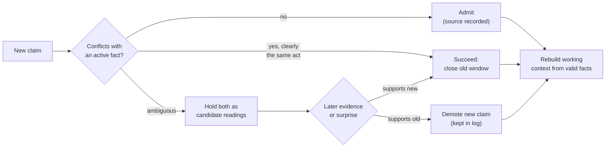

**TLDR**

- Drift, poisoning, catastrophic forgetting and hallucination look like four problems, but they share a structure. The agent has more than one candidate for the same piece of information (an old fact and a newer one, a trusted source and an untrusted one), outputs one, and keeps no record of the alternatives or of why it chose.
- Perception research calls this situation multistability: one ambiguous input supports several interpretations, and the observer reports one at a time. Decades of models explain what moves the choice (evidence, adaptation, noise) and why it lags (hysteresis).
- Language models show the same behavior. In one study, telling a model to reset after a wrong claim recovered 2 of 14 cases, while rebuilding the context from facts recovered 12 of 14.
- The proposal is memory that stores competing candidates with their sources and validity windows, rebuilds the working context from the currently supported ones, abstains in the memory layer when nothing is supported, and measures how much influence a retracted claim still has.
- Status: a survey, with no new experiments. Hypotheses are marked as hypotheses.

Drift, poisoning, catastrophic forgetting and hallucination are usually treated as separate problems, each with its own papers, benchmarks and fixes. They share a structure. In each case the agent holds more than one candidate for the same piece of information: an old fact and a newer one, a trusted source and an untrusted one, an earlier trace and a later one, or a stored fact and a plausible guess. The system produces one of them, and it usually has no record of what the alternatives were or why one was chosen. Without that record, a wrong choice cannot be detected afterward, and a correct one cannot be defended.

Vision science studies this situation under the name multistability: a single ambiguous input supports several interpretations, and the observer perceives one at a time. I read through the literature to see what it offers agent memory. The ingredients exist, spread across separate fields, and I could not find anyone who has combined them.

Treat this as a survey with opinions. I ran no new experiments for it, and wherever a claim rests on an abstract alone, I say so. Where a paper has a figure or table that backs a point, I point to it, so you can check the source instead of taking my word.

## 1. Four failures with one thing in common

| Failure | What it looks like | What is competing |
|---|---|---|
| Drift | An answer shifts after the conversation moves on or a user pushes back | The old context versus the current evidence |
| Poisoning | A false or hostile claim becomes a stored "fact" | An unreliable source versus an established memory |
| Catastrophic forgetting | New learning overwrites old knowledge | New traces versus old traces in a shared store |
| Hallucination | A confident answer with no support | A fluent completion versus nothing stored |

In every row the output looks equally confident whichever side wins. This is why watching output entropy or asking the model whether it is sure helps so little: confidence carries no usable signal in any of these cases.

## 2. The core idea, in one example

Take a user who says "I live in Paris" in March, "I moved to Rome" in June, and "I'm still in Paris most weeks for work" in July. A typical memory system stores three notes, or overwrites one with another, and the answer to "where does the user live?" depends on retrieval order or on whichever note ranks highest. The failure is not the lack of an answer. It is that the system cannot say what it chose between.

The multistability view treats this as one question with competing readings:

1. **Several readings coexist.** "Lives in Paris", "lives in Rome" and "lives in both" are held as candidates, each with its sources, timestamps and a measure of how well the evidence supports it.
2. **One reading is used at a time.** The agent commits to the best-supported reading when it answers, as a perceiver commits to one interpretation of an ambiguous image.
3. **Evidence moves the choice, with some lag.** A new, reliable statement shifts the balance toward a reading. A retracted claim loses support but is not erased, so the log still shows what was said and when.
4. **Recent use lowers priority.** In rivalry, the dominant percept weakens over time and the alternative gets its turn. For retrieval, the analogue is to prevent a recently used fact from crowding out a correct one that ranks slightly lower.
5. **Leftover influence is measured.** After a correction, how much does the superseded reading still affect answers? Rivalry research calls this hysteresis. In agents it can be measured, and that measurement is rarely reported.
6. **With no supported reading, the agent abstains.** An empty result is returned explicitly, without a plausible guess.

The rest of this post collects the evidence for each piece, and marks which pieces are established and which are hypotheses.

## 3. What perception research found

Put a Necker cube in front of someone, or show each eye a different image. They never see a blend. They see one interpretation, and after a while it flips to the other, then flips back. The flips follow rules:

- **Timing is noisy.** Dwell times vary from flip to flip, and noise seems to be a fundamental ingredient, not a nuisance ([Brascamp et al., 2006](https://doi.org/10.1167/6.11.8); [Kim et al., 2005](https://doi.org/10.1016/j.visres.2005.08.009)).
- **The dominant percept weakens.** Models of rivalry rely on adaptation to explain why the dominant percept eventually gives way ([Theodoni et al., 2011](https://doi.org/10.3389/fnhum.2011.00145)).
- **There is memory.** The next percept depends on the recent one, which is hysteresis ([Wilson, 2007](https://doi.org/10.1016/j.visres.2007.07.007)).
- **It looks like inference.** Gershman, Vul and Tenenbaum argue that switching, patchy percepts, fusion and traveling waves all fall out of MCMC sampling over simple graphical models ([2012](https://dspace.mit.edu/handle/1721.1/70125)). Moreno-Bote, Knill and Pouget report that the share of time each percept dominates follows what Bayesian sampling predicts ([PNAS 2011](https://pmc.ncbi.nlm.nih.gov/articles/PMC3145684)), and Hohwy, Roepstorff and Friston make the predictive coding version of the argument ([2008](https://doi.org/10.1016/j.cognition.2008.05.010)).

*See Figure 1 in Moreno-Bote et al. for the bistable stimulus they used, and Figure 5 for the attractor-network model that reproduces their dominance statistics.*

I only read the abstract of the Gershman paper and a summary of the PNAS one. I could not confirm that Gershman makes dwell-time or hysteresis claims, so I am not attributing those to it.

The two figures above are my own schematics, not data from the cited papers. What I take from the literature as an engineer: the brain does not settle an ambiguous input once. It keeps a distribution over readings, shows you one, and lets evidence, fatigue and noise move the winner.

## 4. Language models show the same behavior

The vocabulary already shows up in work on language models, just not in memory design. A caution first: a 2026 preprint that described knowledge conflict and hallucination as attractor-basin competition was withdrawn by its author for premature posting, so I am not relying on it.

- **Blended retrieval is built in.** In modern Hopfield networks, the update rule is equivalent to transformer attention. The energy landscape has fixed points that average over all stored patterns, ones that average over a subset, and ones that store a single pattern ([Ramsauer et al., Hopfield Networks is All You Need](https://arxiv.org/abs/2008.02217)). Retrieving a blend of stored patterns is an expected outcome of the mechanism.
- **Vision-language models commit to one reading.** Across 29 bistable images and 116 manipulations, most of twelve models strongly favored a single interpretation ([Panagopoulou et al., Evaluating VLMs on Bistable Images](https://arxiv.org/abs/2405.19423)). See Figure 2 there, panel (a), for the per-image preference, and Figure 1 for the duck-rabbit example. A separate probe asks whether models perceive or just recall, since they often keep their answer when an illusion is inverted ([Sun et al., VI-Probe](https://arxiv.org/abs/2601.22150)).
- **Conversations have hysteresis.** Shnaidman's [Reset Is Not Recovery](https://arxiv.org/abs/2609.33672) measures it directly. A user repeatedly pushes a wrong answer and then stops. Across 14 model and dataset pairs the mean gap to a clean-context baseline is 0.303, and the model still follows the wrong answer 41.2% of the time after a reset. A same-length neutral history gives a gap of -0.007, so this is about content, not length. See Table 2 for the gap by model.

The same paper tests repairs, and the pattern is the most useful thing I found (Table 4 has the counts):

Telling the model to forget does almost nothing. Rebuilding state from facts does much better. Removing the pressure turns entirely works best, but the authors are clear that deletion is an upper bound, not something you can deploy. Partial removal only helps partway: the mean gap was 0.462 with the full history, 0.278 after dropping the medium and strong turns, and 0.001 after dropping all of them (Table 5). The setup is multiple-choice questions, seven open-weight models, templated pressure and a single seed. Read it as a demonstration of the effect, not a general rate.

## 5. What each failure needs

### Drift: keep state, not history

If telling a model to disregard earlier turns barely works, the transcript is the problem. Stop treating it as the state. Keep a small set of validated facts with validity windows, and rebuild the working context from them each turn. That is where neutral summarization and factual-state reconstruction win in the chart above. Bitemporal stores already work this way: an update closes a window instead of deleting, so "what is true now" and "what was said" stay separate.

### Poisoning: gate on the source

[MemProbe](https://arxiv.org/abs/2609.30558) (Ding et al.) is the most useful recent evaluation here. It turns cognitive-memory paradigms (interference, misinformation, consolidation strength, reconsolidation window) into tests, and runs 56 episodes through six memory systems. Overall scores run from 41.5% (Mem0) to 88.4% (A-MEM), against 88.8% for full context. Source fidelity is the weak spot: 17.7% for Mem0, 41.9% for Graphiti and 66.1% for full context (Table 5). A memory that cannot tell who said something has no defense against a confident false claim. So the admission step should record the source, and refuse or demote claims that contradict a well-supported memory unless the evidence is strong. MemProbe's "consolidation strength" paradigm says the same thing: well-supported memories should resist weak challenges and still give way to reliable ones. Figure 5 there plots each system on a stability and plasticity plane, which is a good picture of the tradeoff.

### Catastrophic forgetting: two stores, selective replay

The neuroscience answer is old. McClelland, McNaughton and O'Reilly argued in 1995 that the brain needs a fast hippocampal store and a slow neocortical one, because a single dense store that learns fast overwrites itself ([Psychological Review](https://doi.org/10.1037/0033-295x.102.3.419)). A recent predictive-coding model of the neocortex found the matching capacity limit. Fontaine and a co-author saw episodic-like recall emerge from a few examples and vanish with many, because dense overlapping representations can only hold so many individual memories ([2509.01987](https://arxiv.org/abs/2509.01987)).

Two cautions from the replay work:

- Replay is not automatically good. In a surprise-gated memory study, offline replay recovered 17.7 and 51.3 points of retention on the oldest classes for two backbones, but replaying only a recent window was worse than no replay ([Mouchon, 2606.31495](https://arxiv.org/abs/2606.31495); ImageNet, single seed).
- Timing matters. Forgetting in LLMs seems to follow an Ebbinghaus-style curve, which is why Feng et al. schedule replay against the model's own sense of time instead of fixed step counts ([FOREVER](https://arxiv.org/abs/2601.03938)).

For agents, the lever is to never overwrite: an append-only episode layer, a distilled layer behind admission rules, and selective consolidation. A lot of 2026 systems now do some version of this under names like sleep, dreaming and Hebbian consolidation (Xie's [SleepGate](https://arxiv.org/abs/2603.14517), Potineni et al.'s [EngramRAG](https://arxiv.org/abs/2609.32049), Zhu et al.'s [HeLa-Mem](https://arxiv.org/abs/2604.16839), Mody et al.'s [CraniMem](https://arxiv.org/abs/2603.15642)). SleepGate claims the interference horizon drops from O(n) to O(log n) with near-perfect retrieval, but on a 793K-parameter model, so it is a mechanism result, not a field one.

### Hallucination: abstain outside the model

Language models write fluent, confident text whether or not the fact is stored, so abstention cannot hang on the model's own confidence. It has to live in the memory layer: if nothing supported comes back, return an explicit empty. The catch is that a gate only helps if whatever writes the answer honors it. A small model can ignore an empty result and answer anyway, so test abstention with the answering model in the loop.

## 6. The window is a dilution problem

We usually describe the limit as size. The evidence points at something else:

- Attention entropy rises as the number of things to track grows, and the capacity limit has been tied to attention spreading out ([Gong et al., Self-Attention Limits Working Memory Capacity](https://arxiv.org/abs/2409.10715); Figure 5 shows entropy against N, on vanilla decoder-only transformers doing N-back tasks).
- Accuracy is highest when the relevant passage sits at the start or end of the context and drops in the middle ([Liu et al., Lost in the Middle](https://arxiv.org/abs/2307.03172); Figure 1 is the U-shaped curve).
- MemProbe found that naive retrieval scores 29.2% on episodes whose evidence is split across turns, against 89.6% when the right turns are handed over directly (Table 7). Space was not the bottleneck. Assembling the evidence was.

So the lever is selection. The size-oriented systems split memory by fidelity, with a lossless recent window and a compressed long-term store (Fang et al.'s [Artificial Hippocampus Networks](https://arxiv.org/abs/2510.07318), Munkhdalai et al.'s [Infini-attention](https://arxiv.org/abs/2404.07143), Behrouz et al.'s [Titans](https://arxiv.org/abs/2501.00663)). The selection-oriented ones use surprise to decide what becomes an event (Fountas et al.'s [EM-LLM](https://arxiv.org/abs/2407.09450), Zhang et al.'s [HiMem](https://arxiv.org/abs/2601.06377)) and relationships to decide what gets retrieved (Gutiérrez et al.'s [HippoRAG](https://arxiv.org/abs/2405.14831)). One cost-minded variant waits to consolidate until it sees sustained recurrence ([Dai et al., RecMem](https://arxiv.org/abs/2605.16045)).

## 7. Where multistability could add something

Most of the above is already established under other names: complementary learning systems, surprise gating, replay, reconsolidation. Song et al.'s [REALM](https://arxiv.org/abs/2609.16053), for instance, revises stored memories from retrieval feedback and shows in ablations that the step helps. The sleep and Hebbian space is crowded enough that another "we added sleep" system contributes little.

What I did not find is anyone treating memory conflict itself as a multistable competition. These are the ideas I would test, flagged as hypotheses:

1. **Keep candidate readings alive.** When a new claim might or might not update an old one, hold both and let later evidence decide, instead of committing at write time. The failure is easy to reproduce: if two facts are matched by exact relation string, an extractor that varies tense or phrasing ("explored" versus "is exploring") leaves both active.
2. **Adapt away from the winner.** In rivalry the dominant percept fatigues. A retrieval policy that damps recently used evidence could let a lower-ranked but correct fact through. It targets distractor saturation, where several near-identical facts fight over the top ranks.
3. **Measure hysteresis.** Treat the leftover influence of a retracted or superseded claim as a first-class metric, the way Reset Is Not Recovery does for conversations. After a correction, how often does the stale value still surface?
4. **Noise.** Rivalry models give noise a causal role. I searched for evidence that injected noise helps agent memory retrieval and found none, so this remains an open question.

None of this has been run. The sketch is a design hypothesis built on the evidence above, and the parts that are not standard, the candidate-readings state and adapting away from the winner, are the parts with the least direct support.

## 8. What I am unsure about

- This is a survey of abstracts, with a few full-text reads. The Gershman PDF was rate-limited when I tried it, so what I say about it comes from its abstract.
- The biology only goes so far. Neurons are not tokens, and rivalry models were fitted to perception experiments, not to storage and retrieval.
- Many 2026 memory papers report different metrics (LLM-judged accuracy versus token-F1), so their numbers cannot be compared across papers.
- My claim that nobody has combined these ideas rests on a bounded set of searches. Not finding it is not the same as it not existing.

## 9. What I would build

An immutable episode layer. A distilled layer that admits claims through a source-aware gate and closes validity windows instead of deleting. A working context rebuilt from valid facts every turn, instead of carrying the transcript forward. Abstention enforced in the memory layer. Selective, surprise-driven consolidation. And hysteresis, stale-value rate and source fidelity reported next to accuracy. Most of that is within reach today. The multistability-specific pieces are where I would spend experiments.

## References

1. Ramsauer, H. et al. *Hopfield Networks is All You Need.* https://arxiv.org/abs/2008.02217
2. McClelland, J. L., McNaughton, B. L., O'Reilly, R. C. (1995). *Why there are complementary learning systems in the hippocampus and neocortex.* Psychological Review. https://doi.org/10.1037/0033-295x.102.3.419
3. Gershman, S. J., Vul, E., Tenenbaum, J. B. (2012). *Multistability and Perceptual Inference.* Neural Computation. https://dspace.mit.edu/handle/1721.1/70125
4. Moreno-Bote, R., Knill, D. C., Pouget, A. (2011). *Bayesian sampling in visual perception.* PNAS. https://pmc.ncbi.nlm.nih.gov/articles/PMC3145684
5. Shnaidman, A. *Reset Is Not Recovery: Evaluating Recoverability from False Conversational Context via Sycophancy Hysteresis.* https://arxiv.org/abs/2609.33672
6. Ding, J. et al. *Probing Stability-Plasticity Tradeoffs in Agent Memory through Cognitive Experimental Paradigms (MemProbe).* https://arxiv.org/abs/2609.30558
7. Panagopoulou, A. et al. *Evaluating Vision-Language Models on Bistable Images.* https://arxiv.org/abs/2405.19423
8. Sun, X. et al. *Do VLMs Perceive or Recall? Probing Visual Perception vs. Memory with Classic Visual Illusions.* https://arxiv.org/abs/2601.22150
9. Gong, D. et al. *Self-Attention Limits Working Memory Capacity of Transformer-Based Models.* https://arxiv.org/abs/2409.10715
10. Liu, N. F. et al. (2023). *Lost in the Middle: How Language Models Use Long Contexts.* https://arxiv.org/abs/2307.03172
11. Mouchon, L. *Surprise as a Signal for Plasticity and Metacognition.* https://arxiv.org/abs/2606.31495
12. Fontaine, L. et al. *Semantic and episodic memories in a predictive coding model of the neocortex.* https://arxiv.org/abs/2509.01987
13. Xie, Y. *SleepGate* (https://arxiv.org/abs/2603.14517); Potineni, B. et al. *EngramRAG* (https://arxiv.org/abs/2609.32049); Zhu, J. et al. *HeLa-Mem* (https://arxiv.org/abs/2604.16839); Mody, P. et al. *CraniMem* (https://arxiv.org/abs/2603.15642); Feng, Y. et al. *FOREVER* (https://arxiv.org/abs/2601.03938)
14. Song, Y. et al. *Retrieval-Driven Memory Reconsolidation for Long-Term LLM Agents (REALM).* https://arxiv.org/abs/2609.16053
15. Fang, Y. et al. *Artificial Hippocampus Networks* (https://arxiv.org/abs/2510.07318); Munkhdalai, T. et al. *Infini-attention* (https://arxiv.org/abs/2404.07143); Behrouz, A. et al. *Titans* (https://arxiv.org/abs/2501.00663); Fountas, Z. et al. *EM-LLM* (https://arxiv.org/abs/2407.09450); Zhang, N. et al. *HiMem* (https://arxiv.org/abs/2601.06377); Jiménez Gutiérrez, B. et al. *HippoRAG* (https://arxiv.org/abs/2405.14831); Dai, Z. et al. *RecMem* (https://arxiv.org/abs/2605.16045)
16. Hohwy, J., Roepstorff, A., Friston, K. (2008). *Predictive coding explains binocular rivalry: An epistemological review.* Cognition. https://doi.org/10.1016/j.cognition.2008.05.010
17. Brascamp, J. W. et al. (2006). *The time course of binocular rivalry reveals a fundamental role of noise.* https://doi.org/10.1167/6.11.8 ; Kim, Y.-J. et al. (2005). *Stochastic resonance in binocular rivalry.* https://doi.org/10.1016/j.visres.2005.08.009 ; Theodoni, P. et al. (2011). *Cortical microcircuit dynamics mediating binocular rivalry.* https://doi.org/10.3389/fnhum.2011.00145 ; Wilson, H. R. (2007). *Minimal physiological conditions for binocular rivalry and rivalry memory.* https://doi.org/10.1016/j.visres.2007.07.007
