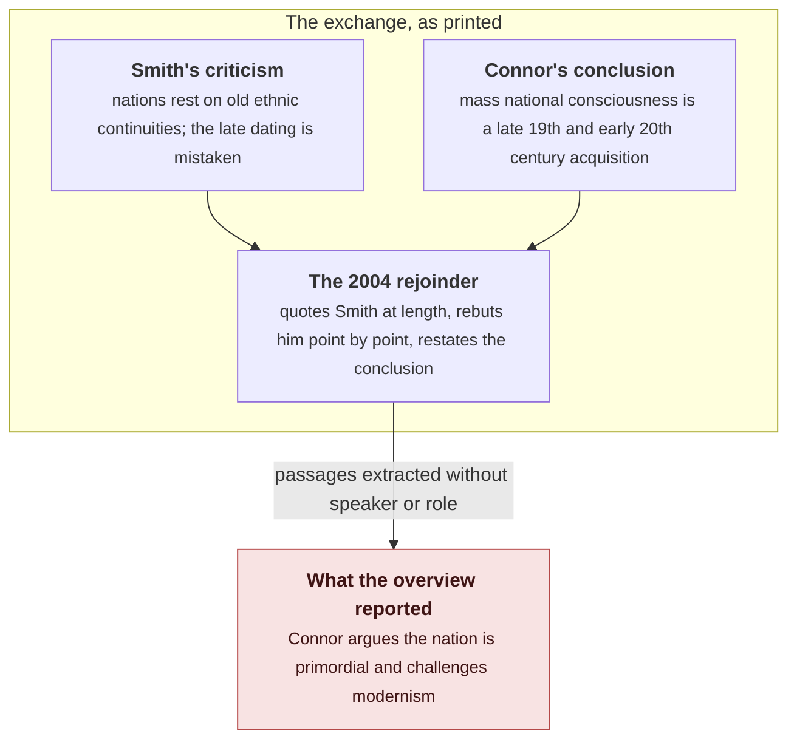

A search results page told the video essayist Shaun that Walker Connor's 2004 article "The Timelessness of Nations" argues that nations are primordial. Shaun had just spent days reading Connor for the video he was writing, and Connor argues the opposite. The overview had taken the opponent's position out of the article and reported it as Connor's.

## 1. The case

Shaun was writing the section of his video on why not to research with AI when he looked up Connor's article. Google's AI overview at the top of the results said:

> In the Timelessness of Nations 2004, political scientist Walker Connor argues that the concept of the nation is inherently primordial and psychologically ancient. He challenges modernist academic views by emphasizing that ethnonational bonds are rooted in deep, often subconscious ancestral attachments rather than recent political constructions. Key takeaways from the article include the myth of recent origins. Connor refutes scholars who date nationalism solely to the 18th century in the French Revolution, arguing that national identity predates modern state building.

Taken as claims about the age of nations, those takeaways describe the position the article was written to answer. Connor's own conclusion is the paper's opening line:

> Anthony Smith has criticized my conclusion that most of the peoples currently recognized as constituting nations acquired national consciousness only in the late nineteenth or early twentieth centuries.

Smith disputed the late dating, and the article replies to that dispute. Shaun reconstructed the structure from the first paragraph and described what the overview had done with it:

> The Google AI summary of this article assigns Walker Connor to the incorrect side of the argument. It claims he is making the point that he is actually arguing against.

Shaun checked because he had just read the author. He names the alternative: "if I hadn't done that, if I'd trusted the AI summary, I would have come away believing this completely incorrect thing." The video's main thread shows what that looks like downstream: a book carrying quotations that no source contains, accepted because the passages read as true.

## 2. What the article argues

Connor's conclusion had been in print since 1990. In "When is a nation?" he argues that Europe's currently recognized nations emerged very recently, often centuries later than the dates their stories assign, and that nation-formation is a process with no single birth certificate: national consciousness is a mass phenomenon, the masses were illiterate and unrecorded until recently, and the point at which enough of a population has internalized the identity cannot be calculated. Eugen Weber's *Peasants into Frenchmen* moved Connor's own chronology for France to the era of the First World War, when state pressure and war reached the peasantry.

Smith's ethno-symbolist reply rests on continuities that make nations possible and that long precede modern statehood, and it disputes the late dating. As the article quotes him, Smith charges Connor with radical modernism. The 2004 paper answers in three moves: a comparison of the two definitions, which Connor argues cannot work because Smith's definition joins civic and ethnic identities that pull against each other; a rejoinder to the specific criticisms; and a restatement of why dating a nation's emergence is so hard in the first place.

Then the turn the title is about. The dating question, Connor argues, matters less than the argument assumes:

> while in factual/chronological history a nation may be of recent vintage, in the popular perception of its members, it is 'eternal', 'beyond time', 'timeless'. And it is not facts but perceptions of facts that shape attitudes and behavior.

The timelessness in the title is a property of the members' perception. The record dates the nation; the people inside it experience it as beyond time; and the experience is what moves them. A nation can be recent on paper and felt as eternal by its members, and Connor's claim is that where behaviour is concerned the feeling is the operative one.

## 3. How the inversion happened

Three causes, each visible in the article itself.

**Quoted opponents are text like any other.** A rejoinder quotes the opposition at length, because rebuttal requires the original claim in front of the reader. At the span level, a sentence asserting that nations are primordial sits inside a document by Connor, and nothing in the sentence carries a wrapper saying who spoke it. Dense similarity treats the opponent's claim and the author's claim as nearly the same content, since both are about the same subject with the same vocabulary. The speaker is discourse structure, and content retrieval discards it. The [embeddings tutorial](/blog/embeddings-from-one-hot-to-retrieval/) builds similarity as distance that matches meaning in the passage; nothing in that construction has a slot for who holds it.

**The title invites the flat reading.** "The Timelessness of Nations," read without the paper, sounds like a claim that nations are old. Inside the paper it is a report about how members perceive their nation. The summary collapses that distinction the same way, and Shaun names this cause first.

**Connor's own vocabulary completes the error.** Connor does argue elsewhere that the ethnonational bond runs through the subconscious and the nonrational, a deep psychological attachment that predates any argument for it. "Psychologically ancient" is half-true of his position, and the overview promotes the half-truth into a chronological claim: from the bond being felt as old, it infers the nation being old. That is precisely the step Connor's closing sentence exists to forbid. The misreading has a history: Conversi's obituary of Connor notes that "it is surprising to see him sometimes designated as a 'primordialist' author," placing him firmly among the modernists instead. The model did not invent the confusion; it reproduced a known one in a single pass, and it added an inversion on top: the overview has Connor arguing that national identity predates modern state building, while his actual argument dates mass national consciousness later than almost anyone.

## 4. Retrieval succeeded, parsing never ran

The pipeline's own signals are all green. The right article was found, the author and year are correct, the passages are on topic, the prose is fluent, the takeaways are well formed. No step raised an error, because no step was tasked with parsing which speaker holds which view.

Content-level evaluation sees no failure either. Recall puts the right article into context, relevance ranks the right passages, the citation names the right paper. The single relation that is wrong, author to position, is invisible to all three. This is why the case reaches beyond one search page: it is the failure mode that content-level metrics are structurally blind to. The [retrieval evaluation post](/blog/retrieval-agents-can-trust-hybrid-rewriting-eval/) measures recall, citations, and abstention, and the retrieval probe in the [GroundMem report](/blog/groundmem-layered-agent-memory-evidence-links/) measures how often evidence reaches the answer at all. Both score what reached the answer. Neither scores whether the retrieved passage asserts the claim or reports it in order to reject it.

The system also had an honest output available. It could have attributed the view ("Smith's position, as Connor quotes it") or declined to characterise the article. It asserted instead, in the register of a key-takeaways list, which is the register that invites copying.

## 5. The write-side mirror

Bring the same article into a memory system and the failure reappears at admission. What proposition would be stored? "Connor argues that nations are primordial" passes any content check: the relevant words are present, the document is the right one, the span is topically exact. The claim fails only when the admission step asks whose assertion it is. The span where those words appear is Smith's, quoted and rebutted. No span in the document has Connor asserting it.

The GroundMem report describes the contract that comes close: propositions carry evidence links to their source spans, a claim is admitted only when its evidence supports it as stated, and a claim the evidence does not support is declined rather than asserted. Applied here, "Connor argues that nations are primordial" has no span in the document where Connor asserts it, so the honest result is abstention. What this case adds is that the evidence link has to record who spoke and in what mode, asserted, quoted, or rebutted, because the span's words alone will support the claim whoever said them.

The general problem scales with the amount of argument in a corpus. Replies, reviews, rebuttals, corrections, and peer responses all store one person's words inside another person's document. Memory that keeps the text and drops the roles converts every rebuttal into a candidate endorsement, and the more disagreement a corpus contains, the more misattributions this produces.

## 6. Perceptions of facts

Connor's closing sentence, written about nations, describes the layer that produced the error about his article. The sentence applies at three levels, and the structure is the same at each one.

At the level of citizens, a nation may be recent in the record and timeless in the perception of its members. The parade and the vote respond to the nation as felt, and revising the chronology in the archive leaves the allegiance untouched, because the allegiance answers to the perception. This is Connor's causal claim: behaviour runs through perception, and the perception is where the facts do their work.

At the level of readers, someone who meets Connor's article through the overview holds a perception of the article that competes with the article itself. That perception, not the text, will shape the reader's attitude toward the argument and any use they make of it. Shaun's warning is exactly Connor's sentence applied to the reading: the false perception would have done its work unnoticed, and the check that stopped it cost one paragraph because he had already read the author.

At the level of the video's main thread, quotations that feel true function as evidence regardless of where they came from. The perception carries the causal force in each case. Truth is optional in that mechanism, though it is not optional in scholarship, and the difference is what verification is for.

A search summary is therefore a perception-generator for documents, and Connor's sentence predicts its failure mode: what shapes the reader is the perceived source. The inversion is more damaging than a wrong date for that reason. A wrong date sits next to the text where it can be corrected. The inverted attribution arrives in fluent prose with a citation attached, shaped like knowledge about the article, and it displaces the article for anyone who does not open it.

## 7. What a system would need

- **Roles at write time.** Store the speaker and the mode of each extracted span, asserted, quoted, or rebutted, when the span is admitted, rather than trying to reconstruct the roles when the answer is composed. The [report's](/blog/groundmem-layered-agent-memory-evidence-links/) admission step is where this decision belongs.
- **Stance in retrieval, not only similarity.** A ranker that ignores who is speaking will place a rebuttal beside an endorsement, and the passage that most efficiently refutes a claim will be indistinguishable from the passage that makes it. The relation has to survive from extraction to answer.
- **Abstain on unsettled attribution.** When the available spans cannot establish who holds a view, the output should say so. The overview had attribution and refusal available and used neither.
- **Quote the frame.** The article's own first sentence names the exchange. A summarisation rule that leads with the source's self-description cannot invert the sides as easily, which makes the cheapest verification the source's lede.
- **Keep the reader's check in the loop.** Shaun's check took a sentence because he had read the author. The system-side equivalent is answers grounded in spans that carry their roles; the reader-side equivalent is opening the source before trusting a summary of it.

## 8. What I cannot claim

This is one observed overview, reproduced in Shaun's video, with no access to the system's retrieval logs. The three-cause account in section 3 is an inference from the article's structure, and each step in it is checkable against the printed text: the quoted passages exist, their speakers are unambiguous, and the chronology is stated in the first sentence.

Nothing here re-measures any system. The benchmarks in the report score content-level standing on their own question sets, and none of them was run on this case.

There is also no claim about what any model believes. The object of criticism is the output's structure: a view attributed to a speaker who holds the opposite view, delivered with a citation that invites trust.

## References

1. Connor, W. (2004). The timelessness of nations. *Nations and Nationalism*, 10(1-2), 35-47. https://doi.org/10.1111/j.1354-5078.2004.00153.x
2. Connor, W. (1990). When is a nation? *Ethnic and Racial Studies*, 13(1), 92-103. https://doi.org/10.1080/01419870.1990.9993663
3. Connor, W. (1993). Beyond reason: The nature of the ethnonational bond. *Ethnic and Racial Studies*, 16(3), 373-389. https://doi.org/10.1080/01419870.1993.9993788
4. Smith, A. D. (1998). *Nationalism and Modernism: A Critical Survey of Recent Theories of Nations and Nationalism.* Routledge.
5. Weber, E. (1976). *Peasants into Frenchmen: The Modernization of Rural France, 1870-1914.* Stanford University Press.
6. Conversi, D. (2017). Walker Connor (1926-2017), pioneer in the study of nationalism. *Nations and Nationalism*, 23(3), 437-440. https://doi.org/10.1111/nana.12331
7. Shaun. *Suicide of a Nation* (video). YouTube, 2026. https://youtu.be/iL3gpxD6_rs
