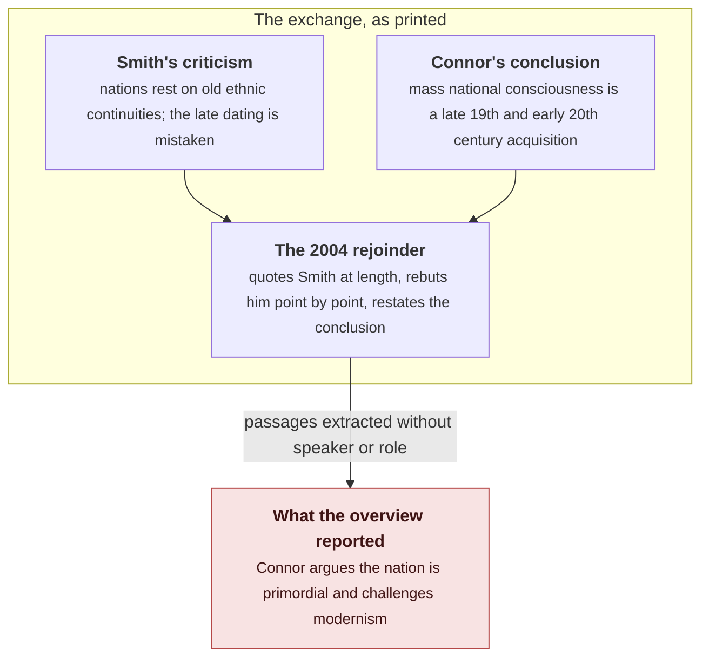

I recently watched [Suicide of a Nation](https://youtu.be/iL3gpxD6_rs), the new video from [Shaun](https://www.youtube.com/@Shaun_vids), a channel that puts out something worth the wait roughly once every nine months. It's about a self-published book that ChatGPT helped write, complete with quotations that no source contains, and it warns against researching that way. Shaun was writing that section of the video when he went to look up one more source: Walker Connor's 2004 article "The Timelessness of Nations". Google's AI overview at the top of the results page told him what the article argues:

> In "The Timelessness of Nations" (2004), political scientist Walker Connor argues that the concept of the nation is inherently primordial and psychologically ancient. He challenges modernist academic views by emphasizing that ethnonational bonds are rooted in deep, often subconscious ancestral attachments rather than recent political constructions.
>
> Key takeaways from the article include:
>
> • The Myth of Recent Origins: Connor refutes scholars who date nationalism solely to the 18th century and the French Revolution, arguing that national identity predates modern state-building.

*Screenshot from Shaun's [Suicide of a Nation](https://youtu.be/iL3gpxD6_rs): the overview as it appeared on the results page.*

Shaun had just spent days reading Connor, so he noticed. I went and checked the abstract myself afterwards: the overview had it backwards. The paper's first sentence settles the matter:

> Anthony Smith has criticized my conclusion that most of the peoples currently recognized as constituting nations acquired national consciousness only in the late nineteenth or early twentieth centuries.

*Screenshot from the same video: the first page of the article as printed.*

Smith disputed the late dating, and the article is Connor's reply. The overview took the very position Connor was answering and filed it under his name. Shaun puts it this way: "The Google AI summary of this article assigns Walker Connor to the incorrect side of the argument. It claims he is making the point that he is actually arguing against."

He only caught it because he had just read the author. "If I hadn't done that, if I'd trusted the AI summary, I would have come away believing this completely incorrect thing," he says. The rest of the video is about what happens when nobody checks: a chatbot's quotations ended up in the book, and stayed there because they read well.

To see how the paper gets inverted, you have to know what the paper says. Connor's conclusion has been in print since 1990. In "When is a nation?" he argues that Europe's currently recognized nations are far younger than their stories claim, often by centuries: national consciousness is something a mass population acquires, the masses were illiterate and unrecorded until recently, and nobody can calculate the moment enough of a population has internalized it. Eugen Weber's *Peasants into Frenchmen* pushed Connor's own chronology for France to the First World War, when state pressure and war finally reached the peasantry. Smith's reply leans on cultural continuities that predate any modern state, and he rejects the late dating; as the article quotes him, he charges Connor with radical modernism. The 2004 paper compares the two definitions and argues that Smith's cannot work, because it welds civic and ethnic identities together that pull against each other. It takes Smith's criticisms one by one, then returns to the problem it started with: dating a nation's emergence is harder than anyone assumes.

Then comes the turn the title is about. The dating question, Connor argues, matters less than the argument assumes:

> while in factual/chronological history a nation may be of recent vintage, in the popular perception of its members, it is 'eternal', 'beyond time', 'timeless'. And it is not facts but perceptions of facts that shape attitudes and behavior.

*Screenshot from the same video: the passage quoted above as it appears in the article.*

The timelessness in the title belongs to the members, not to the record. The record gives the nation a date, but the people inside it experience that nation as beyond time, and it is that experience that moves them. A nation can be recent on paper and still feel eternal to the people in it, and Connor's point is that this feeling is what drives behaviour.

Everything that made the inversion easy was right there on the page.

Quoted opponents are text like any other. A rejoinder quotes the opposition at length, because you cannot rebut a claim without putting it in front of the reader. In the retrieved text, a sentence asserting that nations are primordial simply sits there inside a document by Connor, and nothing in it says who spoke. Dense similarity treats the opponent's claim and the author's claim as nearly the same content, since both talk about the same subject in the same words. Who is speaking belongs to the structure of the text, and content retrieval throws that away. The [embeddings tutorial](/blog/embeddings-from-one-hot-to-retrieval/) on this blog builds similarity as a distance between meanings in a passage; there is nowhere in that construction to put who holds the view.

*Screenshot from the same video: the article quoting Smith at length.*

The title invites the flat reading. "The Timelessness of Nations," read without the paper, sounds like a claim that nations are old. Inside the paper it is a report about how members perceive their nation. Shaun names this cause first, and it is the one he would have fallen for himself if he had only seen the title.

Connor's own vocabulary finishes the job. He does argue elsewhere that the ethnonational bond runs through the subconscious and the nonrational, a deep attachment people feel before they can argue for it. So "psychologically ancient" is half true of his position, and the overview turns that half into a claim about chronology: because the bond feels old, the nation must be old. That is exactly the step Connor's closing sentence is there to stop. The misreading has a history: Conversi's obituary of Connor notes that "it is surprising to see him sometimes designated as a 'primordialist' author," placing him firmly among the modernists instead. The model did not invent the confusion. It repeated a mistake people have made for years, then added an inversion of its own: the overview has Connor arguing that national identity predates modern state building, while his actual argument dates mass national consciousness later than almost anyone.

Retrieval succeeded here; parsing never ran. The pipeline's own signals are all green: it found the right article, got the author and year right, quoted passages that were on topic, and wrote fluent prose with a tidy set of takeaways. Nothing raised an error, because nothing in the pipeline was ever asked to work out which speaker holds which view.

Evaluation on content alone never flags a failure here either. Recall brings the right article into context and relevance puts the right passages on top; the citation names the right paper. The one thing that is wrong, the link between author and position, is invisible to all of them. That is why this matters beyond one search page: no metric that scores content can see this kind of failure at all. The [retrieval evaluation post](/blog/retrieval-agents-can-trust-hybrid-rewriting-eval/) measures recall, citations, and abstention, and the retrieval probe in the [GroundMem report](/blog/groundmem-layered-agent-memory-evidence-links/) measures how often evidence even reaches the answer. Both score what reached the answer. Neither asks whether the retrieved passage asserts the claim or reports it in order to reject it. The system had an honest answer available: it could have attributed the view ("Smith's position, as Connor quotes it") or refused to characterise the article. It asserted instead, in the flat voice of a key-takeaways list, the kind of voice readers copy from.

The same article, dropped into a memory system, fails the moment it comes in. What proposition would be stored? "Connor argues that nations are primordial" passes every content check: the words are there, the document is the right one, the passage is about exactly this. It fails only when the check asks whose assertion it is. The passage where those words appear is Smith's, quoted and then rebutted; no passage in the document has Connor asserting it. The GroundMem report describes a contract that comes close. Every proposition carries an evidence link back to the passage it came from. A claim goes in only when the passage supports it as stated, and anything the passage cannot support is turned away. Here no passage has Connor making the claim, so the honest output is to abstain. What this case adds is that the link has to record who spoke and how, whether they asserted the claim, quoted it, or rebutted it, because the words on their own will support the claim no matter who said them. The problem grows with the amount of argument in a corpus. Every reply, review, and correction stores one person's words inside another person's document. A memory system that keeps the text and drops the roles turns every rebuttal into a possible endorsement, and the more disagreement the corpus contains, the more misattributions come out.

Connor's closing sentence was written about nations, but it describes the thing that produced the error about his own article.

Start with the claim itself: a nation may be recent in the record and timeless in the perception of its members. The parade and the vote answer to the nation as people feel it, and fixing the dates in the archive changes nothing, because the allegiance runs through the feeling. That is Connor's claim about cause: behaviour goes through perception, and facts only matter once somebody has perceived them.

A reader who meets Connor's article through the overview walks away with an idea of the article that fights the article itself. That idea, rather than the text, shapes what the reader thinks of the argument and what they do with it. Shaun's warning is Connor's sentence playing out in reading: the false idea would have done its damage quietly, and the check that stopped it cost one paragraph, because he had already read the author.

The video's main thread shows the same thing: quotations that feel true work as evidence no matter where they came from. In every case, perception is doing the work. The mechanism runs without truth; scholarship does not, and that is what verification is for.

A search summary generates perceptions of documents, and Connor's sentence predicts how it fails: what shapes the reader is the source as perceived, not the source as written. That makes the inversion worse than a wrong date. A wrong date sits next to the text where someone can correct it. The inverted attribution arrives in fluent prose with a citation attached, looks like knowledge of the article, and pushes the article aside for anyone who does not open it.

What would a system need to avoid this? At write time it would have to record who spoke and how, whether as assertion, quotation, or rebuttal, instead of reconstructing that later when the answer is composed. The [report's](/blog/groundmem-layered-agent-memory-evidence-links/) admission step is where that decision belongs. Retrieval would have to care about stance as well as similarity, because a ranker that ignores who is speaking puts a rebuttal next to an endorsement, and the passage that most efficiently refutes a claim looks just like the passage that makes it; the relation has to survive from parsing to answer. When the passages cannot establish who holds a view, the output should say so instead of guessing: the overview had attribution and refusal available and used neither. And a summarisation rule that led with the source's self-description would have helped here, since the article's own first sentence names the exchange, and the cheapest verification is the source's lede.

None of this removes the reader's job. Shaun's check took a sentence because he had read the author. The system has to ground its answers in passages that carry their roles, and the reader still has to open the source before trusting a summary of it.

This is one overview, captured in Shaun's video, and I have no access to the system's retrieval logs. I inferred those causes from the article's structure, and every step can be checked against the printed text: the quoted passages are really there and their speakers are not in doubt; the first sentence carries the chronology. Nothing here re-measures any system. The benchmarks in the report score answers on their own question sets, and none of them was run on this case. I'm also not claiming that any model believes anything. The criticism is about the shape of the output: a view attributed to a speaker who holds the opposite view, delivered with a citation that invites trust.

## References

1. Connor, W. (2004). The timelessness of nations. *Nations and Nationalism*, 10(1-2), 35-47. https://doi.org/10.1111/j.1354-5078.2004.00153.x
2. Connor, W. (1990). When is a nation? *Ethnic and Racial Studies*, 13(1), 92-103. https://doi.org/10.1080/01419870.1990.9993663
3. Connor, W. (1993). Beyond reason: The nature of the ethnonational bond. *Ethnic and Racial Studies*, 16(3), 373-389. https://doi.org/10.1080/01419870.1993.9993788
4. Smith, A. D. (1998). *Nationalism and Modernism: A Critical Survey of Recent Theories of Nations and Nationalism.* Routledge.
5. Weber, E. (1976). *Peasants into Frenchmen: The Modernization of Rural France, 1870-1914.* Stanford University Press.
6. Conversi, D. (2017). Walker Connor (1926-2017), pioneer in the study of nationalism. *Nations and Nationalism*, 23(3), 437-440. https://doi.org/10.1111/nana.12331
7. Shaun. *Suicide of a Nation* (video). YouTube, 2026. https://youtu.be/iL3gpxD6_rs
